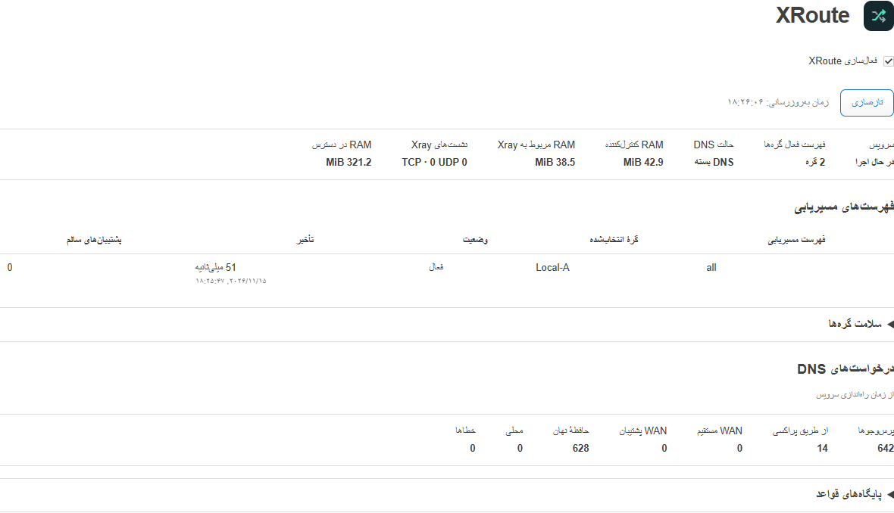

[English](README.md) | [Русский](README-RU.md) | [فارسی](README-FA.md) | [简体中文](README-ZH.md) | [繁體中文](README-ZH-TW.md)

<div dir="rtl">


# XRoute برای OpenWrt

**[نسخهٔ MikroTik RouterOS 7 را اینجا ببینید ←](https://github.com/Ati054/xroute)**

XRoute را ساختم تا پراکسی‌های OpenWrt را از LuCI مدیریت کنم. می‌توانید اشتراک اضافه کنید، برای دستگاه‌ها و وب‌سایت‌ها سرور انتخاب کنید و برای خرابی سرورها مسیر پشتیبان داشته باشید. Xray در خود بسته قرار دارد.

رابط به زبان‌های انگلیسی، روسی، چینی ساده، چینی سنتی و فارسی در دسترس است.



## قابلیت‌ها

- **اشتراک‌ها:** چند منبع را با پیوند، Clash YAML، ‏sing-box JSON یا Xray JSON اضافه کنید. آن‌ها را دستی یا طبق برنامه به‌روزرسانی کنید. دریافت ناموفق، گره‌های قبلی را حفظ می‌کند؛ به‌روزرسانی موفق نیازی به راه‌اندازی مجدد Xray ندارد.
- **پروتکل‌ها:** VLESS، ‏VMess، ‏Trojan، ‏Shadowsocks و Hysteria2. افزونه‌های SIP003 برای Shadowsocks، یعنی v2ray-plugin و obfs-local، از رابط قابل‌نصب‌اند.
- **فهرست‌های مسیر:** تنظیمات جداگانه برای همهٔ دستگاه‌ها، نشانی‌های IP انتخاب‌شده یا زیرشبکه‌ها. دستگاه‌ها را از رزروهای ثابت DHCP در OpenWrt انتخاب کنید یا نشانی‌ها را دستی وارد کنید. گره‌ها را بر اساس نام، اشتراک، کشور، مکان، پروتکل و فیلترها انتخاب کنید.
- **فیلتر نام:** بخش‌های جداشده با ویرگول یا `|` به‌عنوان گزینه‌های جایگزین در نظر گرفته می‌شوند. گیومهٔ دوتایی، تطبیق کامل نام را الزامی می‌کند: `Sweden, "Amsterdam Premium 01"` با نام‌های شامل Sweden و همان گره مشخص Amsterdam منطبق می‌شود. حذف نام‌ها از همین ساختار پیروی می‌کند و اولویت دارد.
- **URLtest:** گره را بر اساس تأخیر HTTPS انتخاب می‌کند. جابه‌جایی به دو تأیید بهبود نیاز دارد تا یک جهش تأخیر باعث تغییر سرور نشود. بررسی دسترس‌پذیری و تغییر مسیر هنگام خرابی مستقل اجرا می‌شوند.
- **اولویت / پشتیبان:** گره‌ها را به ترتیب تعیین‌شده استفاده می‌کند؛ هنگام خرابی به پشتیبان می‌رود و پس از دسترس‌پذیر شدن گره دارای اولویت بالاتر به آن برمی‌گردد.
- **قوانین آماده:** قوانین کشوری برای روسیه، چین و ایران؛ کارت‌های سرویس برای YouTube، ‏Discord، ‏Telegram، ‏WhatsApp، شبکه‌های اجتماعی، خدمات هوش مصنوعی، بازی‌ها، صرافی‌ها و خانهٔ هوشمند. هر کارت صرافی، وب‌سایت و API آن را شامل می‌شود.
- **قوانین سفارشی:** دامنه‌ها، شبکه‌های IP، پورت‌ها، TCP/UDP و پروتکل‌های شناسایی‌شده. ترافیک را از پراکسی فهرست مسیر یا مستقیم از WAN بفرستید؛ نخستین قانون منطبق، مسیر را تعیین می‌کند.
- **عدم دسترسی به همهٔ پراکسی‌ها:** برای هر قانون، مسدودسازی یا دسترسی موقت WAN را انتخاب کنید. می‌توانید برای قوانین آماده و سفارشی اقدام‌های متفاوت تنظیم کنید. پس از بازیابی گره، ترافیک به پراکسی برمی‌گردد.
- **پروتکل‌های سیستم:** نشانی‌های محلی، مسیرهای VPN و استثناهای مستقیم IP بر محدودیت‌های WAN اولویت دارند. ترافیک multicast، ‏broadcast و خطاهای مرتبط ICMP حفظ می‌شوند. Ping از WAN قابل‌مسدودسازی است؛ GRE/ESP خارج از استثناها مسدود می‌شوند. حالت مستقیم IPv6 سایر پروتکل‌ها را محدود نمی‌کند.
- **DNS:** حل‌کننده‌های DNS پراکسی و WAN، ‏DoH/DoT و پردازش درخواست‌های دستگاه‌ها مطابق فهرست مسیر و قوانین آن‌ها. استفادهٔ پشتیبان DNS از WAN تابع تنظیم خرابی پراکسی همان قانون است. اگر سرویس DNS خارجی فعال باشد، DNS روتر در اختیار آن باقی می‌ماند؛ واگذاری کنترل از https-dns-proxy به تأیید جداگانه نیاز دارد.
- **پایش:** مشاهدهٔ گره فعال و پشتیبان‌ها، دسترس‌پذیری، تأخیر و مقایسهٔ Delta. نشانگر را روی Delta نگه دارید تا زمان هر دو اندازه‌گیری را ببینید: مقدار منفی یعنی سریع‌تر و مثبت یعنی کندتر. مصرف حافظهٔ فرایندها، RAM آزاد و تعداد نشست‌های TCP/UDP نیز قابل‌مشاهده‌اند.
- **به‌روزرسانی‌ها:** بررسی GitHub و نصب با یک دکمه، همراه با حفظ تنظیمات؛ بارگذاری دستی APK نیز در دسترس است. بسته‌ها با کلید امضای پروژه تأیید می‌شوند. به‌روزرسانی فشرده، APK و پشتیبان را در RAM نگه می‌دارد.

اشتراک‌ها را به‌روزرسانی کنید، گره را عوض کنید و فاصله‌های پایش را بدون راه‌اندازی مجدد سرویس تغییر دهید. هنگام اعمال تنظیمات، XRoute تاریخچه و گره انتخاب‌شده را حفظ می‌کند، مشروط بر اینکه گره همچنان با فهرست مسیر منطبق باشد.

برای هر قانون انتخاب کنید که هنگام خرابی پراکسی، ترافیک مسدود شود یا از WAN عبور کند. DNS نیز از همان قانون پیروی می‌کند. فهرست‌های سخت‌گیرانه هنگام بالا آمدن روتر، راه‌اندازی مجدد و به‌روزرسانی بسته، ترافیک را مسدود نگه می‌دارند. استثناهای مستقیم IP و مسیرهای VPN در دسترس می‌مانند. خاموش کردن XRoute، رهگیری ترافیک را برمی‌دارد.

هنگام به‌روزرسانی، برق روتر را قطع نکنید. اگر فضای فلش کم باشد، نصب‌کننده پشتیبان بسته را در RAM نگه می‌دارد. قطع برق در این مرحله ممکن است نصب مجدد APK را ضروری کند. تنظیمات شما روی روتر باقی می‌مانند. برای بازیابی، APK را طبق دستورهای پایین منتقل و دستور `apk --no-cache add --force-reinstall /tmp/xroute.apk` را اجرا کنید.

## نصب

به **OpenWrt 25.12 با APK و معماری ARM64 یا x86_64** نیاز دارید. معماری بسته را در `/etc/apk/arch` بررسی کنید.

حداقل ۲۵۶ مگابایت RAM پیشنهاد می‌شود. فضای آزاد فلش به firmware بستگی دارد؛ نصب‌کننده پیش از نصب آن را بررسی می‌کند.

| معماری | APK |
|---|---|
| `aarch64_generic` | ساخت ARM64 Generic |
| `aarch64_cortex-a53` | ساخت Cortex-A53 / Filogic |
| `x86_64` | ساخت x86-64 |

دستور زیر را در ترمینال رایانهٔ خود، از جمله Windows PowerShell، اجرا کنید. به‌جای `192.168.1.1`، نشانی IP روتر خود را بگذارید:

<div dir="ltr">

```sh
ssh root@192.168.1.1 "wget -O /tmp/xroute-install.sh https://raw.githubusercontent.com/Ati054/xroute-openwrt/main/install.sh && sh /tmp/xroute-install.sh"
```

</div>

نصب‌کننده معماری را تشخیص می‌دهد، فضای آزاد را بررسی می‌کند، آخرین نسخهٔ پایدار را دریافت می‌کند، امضای APK و SHA-256 را تأیید می‌کند و وابستگی‌ها را نصب می‌کند.

### اگر روتر به GitHub دسترسی ندارد

1. معماری آن را بررسی کنید: `ssh root@192.168.1.1 "cat /etc/apk/arch"`.
2. APK مناسب را از [انتشارها](https://github.com/Ati054/xroute-openwrt/releases) و [نصب‌کننده](https://raw.githubusercontent.com/Ati054/xroute-openwrt/main/install.sh) دریافت کنید. آن‌ها را در یک پوشه با نام‌های `xroute.apk` و `install.sh` ذخیره کنید.
3. PowerShell را در همان پوشه باز و دستورهای زیر را اجرا کنید:

   <div dir="ltr">

   ```powershell
   scp -O .\xroute.apk .\install.sh root@192.168.1.1:/tmp/
   ssh root@192.168.1.1 "sh /tmp/install.sh --local /tmp/xroute.apk"
   ```

   </div>

گزینهٔ `-O` از SCP سازگار با Dropbear استفاده می‌کند. نصب‌کننده پیش از نصب، APK را با کلید ثابت پروژه تأیید می‌کند. برای وابستگی‌های نصب‌نشده، دسترسی به مخازن OpenWrt همچنان لازم است.

### راه‌اندازی

پس از نخستین نصب، سرویس غیرفعال است. در LuCI بخش **سرویس‌ها ← XRoute** را باز کنید:

1. در حالی که سرویس هنوز غیرفعال است، اشتراک‌ها را اضافه و گره‌ها را دریافت کنید.
2. قوانین و فهرست‌های مسیر را بسازید؛ سپس دستگاه‌ها و گره‌ها را انتخاب کنید.
3. DNS را تنظیم کنید، XRoute را فعال کنید و تنظیمات را ذخیره و اعمال کنید.

اشتراک‌ها سقف تعداد گره ندارند. هنگام وارد کردن، XRoute اندازهٔ داده و فضای آزاد را بررسی می‌کند.

پایگاه‌های داده برای قوانین متصل به فهرست‌های مسیر دریافت می‌شوند. اگر قانونی را بعداً متصل کنید، با اعمال تنظیمات، پایگاه‌های دادهٔ مفقود آن خودکار بارگیری می‌شوند. پیشرفت دریافت و خطاها در صفحهٔ نمای کلی نمایش داده می‌شوند.

برای جابه‌جایی از PassWall2، پیش از فعال‌سازی XRoute، آن را متوقف کنید و اجرای خودکارش را در **سیستم ← راه‌اندازی** غیرفعال کنید. تا وقتی XRoute غیرفعال است می‌توانید اشتراک‌ها و قوانین را آماده کنید. اگر فهرست همهٔ دستگاه‌ها وجود نداشته باشد، سایر نشانی‌ها همچنان از WAN استفاده می‌کنند.

هنگام آغاز سرویس و بازیابی، دسترسی موقت WAN با حل‌کنندهٔ DNS در OpenWrt فقط برای فهرست‌هایی در دسترس است که WAN را برای تمام ترافیک پراکسی مجاز می‌کنند. فهرست‌های سخت‌گیرانه و DNS آن‌ها مسدود می‌مانند. اگر خواندن یا اعتبارسنجی تنظیمات ممکن نباشد، ترافیک پراکسی مسدود می‌ماند. قوانین مبتنی بر دامنه به هستهٔ سالم نیاز دارند؛ بازیابی سرویس خودکار ادامه می‌یابد.

برای به‌روزرسانی، بخش **به‌روزرسانی بسته ← بررسی به‌روزرسانی ← به‌روزرسانی از GitHub** را باز کنید. بررسی فقط اطلاعات نسخه را دریافت می‌کند؛ دریافت و نصب پس از کلیک جداگانه روی **به‌روزرسانی از GitHub** آغاز می‌شود. می‌توانید نسخه‌های میانی را رد کنید. تنظیمات و وضعیت فعال یا غیرفعال سرویس حفظ می‌شوند؛ سرویس در حال اجرا، هنگام به‌روزرسانی دوباره راه‌اندازی می‌شود.

برای شمارنده‌ها و دستورهای لازم در گزارش مشکل، [عیب‌یابی DNS](docs/DNS-DIAGNOSTICS.en.md) را بخوانید.

## ساخت

از SDK مربوط به OpenWrt 25.12 برای هدف ARM64 یا x86/64 خود و Go 1.27.4 استفاده کنید. مخزن را در `SDK/package/resproxy` قرار دهید و اجرا کنید:

<div dir="ltr">

```sh
make -C SDK/package/resproxy TOPDIR=/absolute/path/to/SDK compile V=s
```

</div>

وابستگی‌ها در `vendor` قرار دارند؛ سورس هسته در `third_party/xray-core` است.

## مجوزها

پروژه از AGPL-3.0 استفاده می‌کند. مجوزهای هسته و وابستگی‌ها در [LICENSE](LICENSE)، ‏[NOTICE.md](NOTICE.md)، ‏`vendor` و `third_party` حفظ شده‌اند.

## پرسش‌های متداول

**آیا می‌توان فقط وب‌سایت‌ها یا دستگاه‌های انتخاب‌شده را از پراکسی عبور داد؟**

بله. یک اشتراک اضافه کنید، برای سرویس، دامنه یا IP، قانونی با اقدام پراکسی
بسازید و آن را به فهرست مسیر دستگاه‌های موردنظر متصل کنید. اگر سایر ترافیک
باید مستقیم بماند، مسیر آن را WAN قرار دهید. برای MikroTik RouterOS 7 از
[نسخهٔ MikroTik و راه‌اندازی رابط وب آن](https://github.com/Ati054/xroute) استفاده کنید.

**XRoute چه تفاوتی با Podkop و PassWall2 دارد؟**

[Podkop](https://github.com/itdoginfo/podkop/blob/main/README.md) از sing-box استفاده می‌کند.
[PassWall2](https://github.com/Openwrt-Passwall/openwrt-passwall2/blob/main/README.md)
از چند هستهٔ پراکسی و بسته‌های مرتبط پشتیبانی می‌کند. XRoute یک هستهٔ Xray
دارد و اشتراک‌ها، فهرست‌های مسیر، انتخاب گره و DNS را در رابط LuCI خود مدیریت
می‌کند. این بسته برای OpenWrt 25.12 با APK روی ARM64 و x86_64 طراحی شده است.

</div>
