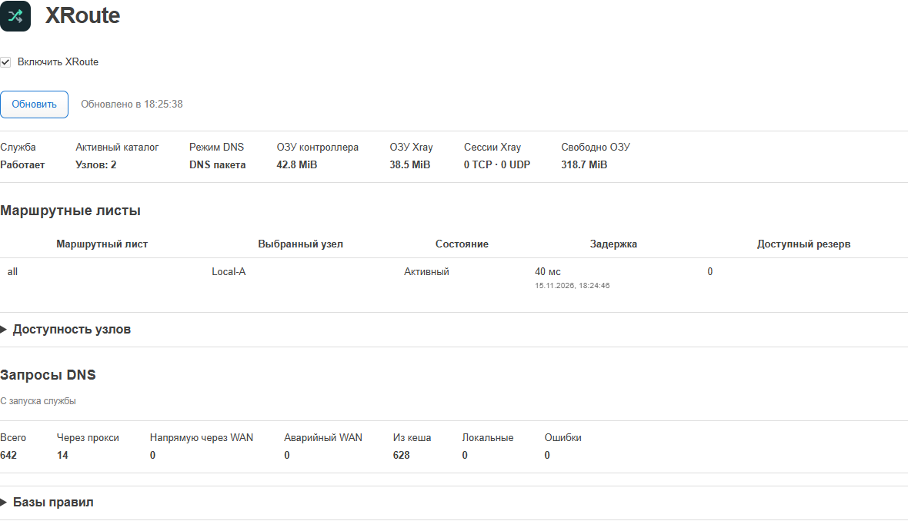

[English](README.md) | [Русский](README-RU.md) | [فارسی](README-FA.md) | [简体中文](README-ZH.md) | [繁體中文](README-ZH-TW.md)


# XRoute for OpenWrt

**[Версия для MikroTik RouterOS7 здесь →](https://github.com/Ati054/xroute)**

Я сделал XRoute, чтобы управлять прокси на OpenWrt из LuCI. Здесь можно добавить подписки, выбрать серверы для устройств и сайтов, настроить резерв на случай отказа. Xray входит в пакет.

В интерфейсе можно выбрать русский, английский, упрощённый или традиционный китайский и фарси.



## Возможности

- **Подписки:** добавляйте несколько источников со ссылками, Clash YAML, sing-box JSON или Xray JSON. Обновляйте их вручную или по расписанию. При ошибке загрузки остаются прежние узлы; успешное обновление не требует перезапуска Xray.
- **Протоколы:** VLESS, VMess, Trojan, Shadowsocks и Hysteria2. Для Shadowsocks доступны устанавливаемые из интерфейса SIP003-плагины v2ray-plugin и obfs-local.
- **Маршрутные листы:** отдельные настройки для всех устройств, выбранных IP-адресов или подсетей. Устройства можно выбрать из статических DHCP-привязок OpenWrt или указать вручную. Выбор узлов по названию, подписке, стране, локации, протоколу и фильтрам.
- **Фильтры названий:** части названия через запятую или `|` работают как «ИЛИ». В двойных кавычках задаётся полное название. Например, `Швеция, "Амстердам Premium 01"` выбирает узлы со «Швеция» в названии и конкретный узел «Амстердам Premium 01». Те же правила действуют для исключений; исключения имеют приоритет.
- **URLtest:** выбирайте узел по задержке HTTPS. Для переключения нужны два подтверждения преимущества, чтобы не менять сервер из-за одного скачка задержки. Проверки доступности и переход на резерв работают отдельно.
- **Приоритет / резерв:** использование узлов в заданном порядке, переход на резерв при отказе и возврат к доступному узлу с более высоким приоритетом.
- **Правила:** готовые наборы для России, Китая и Ирана; карточки YouTube, Discord, Telegram, WhatsApp, социальных сетей, AI-сервисов, игр, бирж и умного дома. Сайт биржи и её API включены в одну карточку.
- **Свои правила:** домены, IP-сети, порты, TCP/UDP и определяемые протоколы. Выберите прокси маршрутного листа или прямой выход через WAN; первое совпадение задаёт маршрут.
- **При отказе всех прокси:** выберите в правиле блокировку или временный выход через WAN. Для готовых карточек и своих правил можно задать разные действия. После восстановления узла трафик вернётся на прокси.
- **Системные протоколы:** локальные адреса, VPN и прямые IP-исключения обрабатываются раньше ограничений WAN. Multicast, broadcast и связанные ICMP-ошибки сохраняются. WAN ping можно заблокировать; GRE/ESP вне исключений блокируются. В режиме IPv6 «напрямую» ограничение протоколов не применяется.
- **DNS:** настройки резолверов для прокси и WAN, DoH/DoT, обработка запросов устройств с учётом маршрутного листа и правил. Выход DNS через WAN при отказе определяется правилом. При работе сторонней DNS-службы сохраняется DNS OpenWrt; передача DNS от https-dns-proxy подтверждается отдельно.
- **Мониторинг:** смотрите активный узел и резерв, доступность, задержку и сравнение Delta. При наведении на Delta видны времена обоих замеров: минус означает быстрее, плюс означает медленнее. На странице также есть расход памяти, свободная ОЗУ и число TCP/UDP-сессий.
- **Обновления:** проверка GitHub и установка по кнопке с сохранением настроек; ручная загрузка APK также доступна. Пакеты проверяются по подписи проекта; APK и резервная копия при компактном обновлении хранятся в RAM.

Обновляйте подписки, переключайте узлы и меняйте интервалы мониторинга без перезапуска службы. При применении настроек XRoute сохраняет историю и выбранный узел, если он подходит под новые условия листа.

Для каждого правила выберите поведение при отказе прокси: блокировку или выход через WAN. DNS следует тому же правилу. Строгие листы сохраняют блокировку при загрузке роутера, перезапуске и обновлении пакета. Прямые IP-исключения и маршруты VPN продолжают работать. При выключении XRoute роутер перестаёт перехватывать трафик.

Не отключайте питание роутера во время обновления. При нехватке места установщик хранит резервную копию пакета в ОЗУ. Если в этот момент пропадёт питание, может потребоваться повторная установка APK. Настройки останутся на роутере. Для восстановления загрузите APK по инструкции ниже и выполните `apk --no-cache add --force-reinstall /tmp/xroute.apk`.

## Установка

Нужна **OpenWrt 25.12 с APK, ARM64 или x86_64**. Проверьте архитектуру пакетов в `/etc/apk/arch`.

Рекомендуется от 256 МБ ОЗУ. Доступное место на флеш-памяти зависит от прошивки; установщик проверяет его перед установкой.

| Архитектура | APK |
|---|---|
| `aarch64_generic` | Сборка ARM64 Generic |
| `aarch64_cortex-a53` | Сборка Cortex-A53 / Filogic |
| `x86_64` | Сборка x86-64 |

Выполните в терминале ПК, в том числе в Windows PowerShell. Замените `192.168.1.1` на IP роутера:

```sh
ssh root@192.168.1.1 "wget -O /tmp/xroute-install.sh https://raw.githubusercontent.com/Ati054/xroute-openwrt/main/install.sh && sh /tmp/xroute-install.sh"
```

Скрипт определит архитектуру, проверит место, скачает последнюю стабильную версию, проверит подпись APK и SHA-256, затем установит зависимости.

### Если роутер не открывает GitHub

1. Узнайте архитектуру: `ssh root@192.168.1.1 "cat /etc/apk/arch"`.
2. Скачайте подходящий APK из [Releases](https://github.com/Ati054/xroute-openwrt/releases) и [установщик](https://raw.githubusercontent.com/Ati054/xroute-openwrt/main/install.sh). Сохраните их в одной папке как `xroute.apk` и `install.sh`.
3. Откройте PowerShell в этой папке и выполните:

   ```powershell
   scp -O .\xroute.apk .\install.sh root@192.168.1.1:/tmp/
   ssh root@192.168.1.1 "sh /tmp/install.sh --local /tmp/xroute.apk"
   ```

`-O` включает SCP для Dropbear. Установщик проверяет APK по встроенному ключу проекта. Для недостающих зависимостей нужен доступ к репозиториям OpenWrt.

### Обновление с SB Gateway

Один раз запустите установщик выше. Он заменит старый пакет на XRoute одной транзакцией APK, сохранив настройки, подписки, правила и автозапуск. Загрузчик старого пакета в LuCI не принимает APK с новым именем. После перехода обновляйтесь через **XRoute → Обновление пакета**.

Служба и пути настроек `resproxy` сохранены: текущие настройки и команды диагностики продолжают работать. Имя APK — `xroute-openwrt`.

### Настройка

После первой установки служба выключена. Откройте **Службы → XRoute** в LuCI:

1. Добавьте подписки и загрузите узлы при выключенной службе.
2. Создайте правила и маршрутные листы, выберите устройства и узлы.
3. Настройте DNS, включите XRoute, сохраните и примените настройки.

Ограничения по числу узлов в подписке нет. При импорте XRoute проверяет размер данных и свободное место.

Базы скачиваются для правил, подключённых к маршрутным листам. Если подключить правило позже и применить настройки, недостающие базы загрузятся автоматически. Ход загрузки и ошибки видны в обзоре.

При переходе с PassWall2 сначала остановите его и отключите автозапуск в **Система → Автозагрузка**. Подписки и правила XRoute можно подготовить заранее, пока он выключен. Если нет листа «Все устройства», остальные адреса продолжают работать через WAN.

При запуске и восстановлении службы временный выход через WAN со штатным DNS OpenWrt доступен только листам с разрешением WAN для всего прокси-трафика. Строгие листы и их DNS остаются закрытыми. Если настройки нельзя прочитать или проверить, прокси-трафик остаётся закрытым. Без работающего ядра условные правила по доменам недоступны; восстановление службы продолжается автоматически.

Для обновления откройте **Обновление пакета → Проверить обновления → Обновить с GitHub**. Проверка получает сведения о версии; скачивание и установка начинаются после отдельного нажатия «Обновить с GitHub». Промежуточные версии можно пропускать. Настройки и состояние включения службы сохраняются; работающая служба перезапускается.

Для разбора ошибок используйте [диагностику DNS](docs/DNS-DIAGNOSTICS.md). В ней описаны счётчики и команды для отчёта о проблеме.

## Сборка

Используйте OpenWrt 25.12 SDK для нужной цели ARM64 или x86/64 и Go 1.27.4. Поместите репозиторий в `SDK/package/resproxy` и выполните:

```sh
make -C SDK/package/resproxy TOPDIR=/absolute/path/to/SDK compile V=s
```

Зависимости находятся в `vendor`, исходники ядра в `third_party/xray-core`.

## Лицензии

AGPL-3.0 для проекта; лицензии ядра и зависимостей сохранены в [LICENSE](LICENSE), [NOTICE.md](NOTICE.md), `vendor` и `third_party`.

## Частые вопросы

**Можно направлять через прокси только выбранные сайты или устройства?**

Да. Добавьте подписку, создайте правило для сервиса, доменов или IP с действием «прокси» и прикрепите его к маршрутному листу нужных устройств. Для остального трафика выберите WAN, если он должен идти напрямую. Для MikroTik RouterOS 7 используйте [версию для MikroTik и её настройку через Web-интерфейс](https://github.com/Ati054/xroute).

**Чем XRoute отличается от Podkop и PassWall2?**

[Podkop](https://github.com/itdoginfo/podkop/blob/main/README.md) использует sing-box. [PassWall2](https://github.com/Openwrt-Passwall/openwrt-passwall2/blob/main/README.md) поддерживает несколько прокси-ядер и связанных пакетов. XRoute включает одно ядро Xray и объединяет подписки, маршрутные листы, выбор узлов и DNS в своём интерфейсе LuCI. Этот пакет рассчитан на OpenWrt 25.12 с APK, ARM64 и x86_64.
