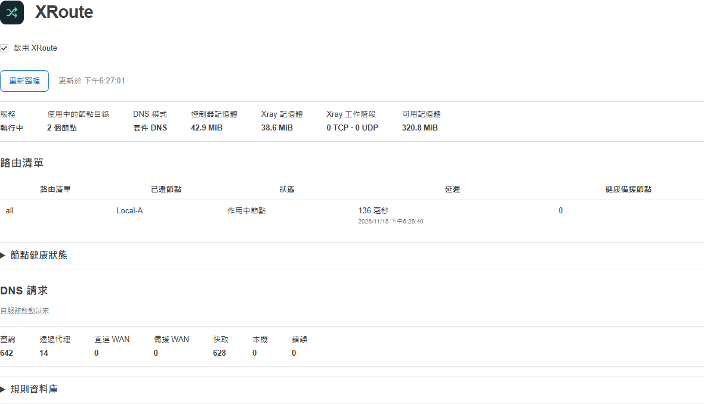
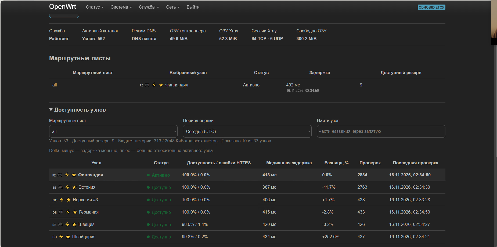

[English](README.md) | [Русский](README-RU.md) | [فارسی](README-FA.md) | [简体中文](README-ZH.md) | [繁體中文](README-ZH-TW.md)


# XRoute for OpenWrt

**[MikroTik RouterOS 7 版本請見此處 →](https://github.com/Ati054/xroute)**

我開發 XRoute，是為了從 LuCI 管理 OpenWrt 上的代理。您可以新增訂閱、為裝置與網站選擇伺服器，並設定伺服器故障時的備援。套件已包含 Xray。

介面支援英文、俄文、簡體中文、繁體中文與波斯文。



## 功能

- **訂閱：**可新增多個來源，支援連結、Clash YAML、sing-box JSON 與 Xray JSON。可手動或排程更新。下載失敗時會保留先前的節點；更新成功後無須重新啟動 Xray。
- **協定：**支援 VLESS、VMess、Trojan、Shadowsocks 與 Hysteria2。可從介面安裝 Shadowsocks SIP003 外掛 v2ray-plugin 與 obfs-local。
- **路由清單：**為所有裝置、指定 IP 位址或子網路分別設定。可從 OpenWrt 靜態 DHCP 保留項目選取裝置，也可手動輸入位址。支援依名稱、訂閱、國家、位置、協定與篩選條件選取節點。
- **名稱篩選：**以逗號或 `|` 分隔的片段代表不同的符合選項。雙引號表示必須完整符合名稱：`Sweden, "Amsterdam Premium 01"` 會匹配名稱含有 Sweden 的節點，以及指定的 Amsterdam 節點。排除條件使用相同語法，且具有優先權。
- **URLtest：**依 HTTPS 延遲選取節點。改善必須經過兩次確認才會切換，避免單次延遲突增就更換伺服器。可用性檢查與容錯移轉獨立執行。
- **優先順序／備援：**依指定順序使用節點，節點故障時切換至備援，並在較高優先節點恢復可用後切回。
- **預設規則：**提供俄羅斯、中國與伊朗的國家規則，以及 YouTube、Discord、Telegram、WhatsApp、社群網路、AI 服務、遊戲、交易所與智慧家庭的服務卡片。每張交易所卡片均涵蓋其網站與 API。
- **自訂規則：**支援網域、IP 網路、連接埠、TCP/UDP 與偵測到的協定。可讓流量經由路由清單的代理，或直接經由 WAN；第一條符合的規則決定路徑。
- **所有代理均無法使用時：**可為每條規則選擇封鎖或暫時使用 WAN。預設規則與自訂規則可設定不同處理方式。節點恢復後，流量會回到代理。
- **系統協定：**本機位址、VPN 路由與直接連線 IP 例外優先於 WAN 限制。保留多播、廣播及相關 ICMP 錯誤。可封鎖 WAN Ping；例外範圍外的 GRE/ESP 會遭封鎖。IPv6 直接模式不限制其他協定。
- **DNS：**支援代理與 WAN 解析器、DoH/DoT，並依裝置所屬的路由清單與規則處理查詢。DNS 的 WAN 備援依循該規則的代理故障設定。若已有作用中的外部 DNS 服務，會保留 OpenWrt DNS；接管 https-dns-proxy 需要另外確認。
- **監控：**檢視作用中節點與備援、可用性、延遲及 Delta 比較。將游標停在 Delta 上可查看兩次測量的時間：負值表示較快，正值表示較慢。也可檢查程序記憶體、可用 RAM 與 TCP/UDP 工作階段數。
- **更新：**可在介面檢查 GitHub 並按一下安裝，同時保留設定；也支援手動上傳 APK。套件會使用專案簽署金鑰驗證。精簡更新會將 APK 與備份保留在 RAM 中。

更新訂閱、切換節點與變更監控間隔，皆無須重新啟動服務。套用設定時，只要節點仍符合路由清單，XRoute 就會保留歷程與所選節點。

可為每條規則選擇代理故障時封鎖流量或允許使用 WAN，DNS 也會遵循相同規則。嚴格清單會在路由器開機、服務重新啟動及套件更新期間維持封鎖。直接連線 IP 例外與 VPN 路由仍可使用。關閉 XRoute 會移除流量攔截。

更新期間請保持路由器通電。若快閃儲存空間不足，安裝程式會將套件備份保留在 RAM。此時斷電可能需要重新安裝 APK，但設定仍會保留在路由器上。復原時，請依下方說明傳送 APK，再執行 `apk --no-cache add --force-reinstall /tmp/xroute.apk`。

## 安裝

需要 **OpenWrt 25.12、APK，以及 ARM64 或 x86_64 架構**。請在 `/etc/apk/arch` 檢查套件架構。

建議至少配備 256 MB RAM。可用的快閃儲存空間依韌體而異，安裝程式會在安裝前檢查。

| 架構 | APK |
|---|---|
| `aarch64_generic` | ARM64 Generic 版本 |
| `aarch64_cortex-a53` | Cortex-A53／Filogic 版本 |
| `x86_64` | x86-64 版本 |

請在電腦的終端機中執行下列指令，也適用於 Windows PowerShell。將 `192.168.1.1` 換成路由器的 IP 位址：

```sh
ssh root@192.168.1.1 "wget -O /tmp/xroute-install.sh https://raw.githubusercontent.com/Ati054/xroute-openwrt/main/install.sh && sh /tmp/xroute-install.sh"
```

安裝程式會偵測架構、檢查可用空間、下載最新穩定版本、驗證 APK 簽章與 SHA-256，並安裝相依套件。

### 路由器無法存取 GitHub 時

1. 檢查架構：`ssh root@192.168.1.1 "cat /etc/apk/arch"`。
2. 從 [Releases](https://github.com/Ati054/xroute-openwrt/releases) 下載對應的 APK 與[安裝程式](https://raw.githubusercontent.com/Ati054/xroute-openwrt/main/install.sh)，將兩者以 `xroute.apk` 與 `install.sh` 的名稱儲存在同一資料夾。
3. 在該資料夾開啟 PowerShell 並執行：

   ```powershell
   scp -O .\xroute.apk .\install.sh root@192.168.1.1:/tmp/
   ssh root@192.168.1.1 "sh /tmp/install.sh --local /tmp/xroute.apk"
   ```

`-O` 讓 SCP 可搭配 Dropbear 使用。安裝程式會在安裝前，使用固定的專案金鑰驗證 APK。若缺少相依套件，仍需能存取 OpenWrt 軟體庫。

### 設定

首次安裝後，服務預設停用。請在 LuCI 開啟 **服務 → XRoute**：

1. 在服務仍停用時，新增訂閱並下載節點。
2. 建立規則與路由清單，再選取裝置及節點。
3. 設定 DNS、啟用 XRoute，然後儲存並套用設定。

訂閱沒有節點數上限。XRoute 會在匯入時檢查資料大小與可用空間。

資料庫會針對已附加至路由清單的規則下載。稍後附加規則並套用設定時，會自動載入缺少的資料庫。總覽頁面會顯示下載進度與錯誤。

若要從 PassWall2 切換，請先在 **系統 → 啟動** 中停止 PassWall2，並停用其自動啟動，再啟用 XRoute。XRoute 停用時仍可準備訂閱與規則。未建立所有裝置清單時，其他位址會繼續使用 WAN。

服務啟動及復原期間，只有允許所有代理流量使用 WAN 的清單，才能暫時經由 WAN 存取，並使用 OpenWrt DNS 解析器。嚴格清單及其 DNS 仍會維持封鎖。若無法讀取或驗證設定，代理流量會維持封鎖。網域規則需要正常運作的核心；服務會持續自動復原。

若要更新，請開啟 **套件更新 → 檢查更新 → 從 GitHub 更新**。「檢查更新」僅取得版本資訊；另外按下「從 GitHub 更新」後，才會開始下載及安裝。您可以跳過中間版本。設定與服務的啟用或停用狀態均會保留；若服務正在執行，更新時會重新啟動。

問題回報所需的計數器與指令，請參閱 [DNS 診斷](docs/DNS-DIAGNOSTICS.en.md)。

## 建置

使用適用於 ARM64 或 x86/64 目標的 OpenWrt 25.12 SDK，以及 Go 1.27.4。將儲存庫放在 `SDK/package/resproxy`，然後執行：

```sh
make -C SDK/package/resproxy TOPDIR=/absolute/path/to/SDK compile V=s
```

相依套件已包含在 `vendor` 中；核心原始碼位於 `third_party/xray-core`。

## 授權

專案使用 AGPL-3.0。核心與相依套件的授權保留在 [LICENSE](LICENSE)、[NOTICE.md](NOTICE.md)、`vendor` 與 `third_party` 中。

## 常見問題

**可以只讓指定網站或裝置使用代理嗎？**

可以。新增訂閱，建立動作為代理的服務、網域或 IP 規則，
再將規則附加至所需裝置使用的路由清單。若其他流量應維持直接連線，請將其設為 WAN。
若您使用 MikroTik RouterOS 7，請參閱 [MikroTik 版本與網頁介面設定](https://github.com/Ati054/xroute)。

**XRoute 與 Podkop 和 PassWall2 有什麼不同？**

[Podkop](https://github.com/itdoginfo/podkop/blob/main/README.md) 使用 sing-box。
[PassWall2](https://github.com/Openwrt-Passwall/openwrt-passwall2/blob/main/README.md) 支援多種代理核心與相關套件。
XRoute 內含單一 Xray 核心，並透過 LuCI 介面管理訂閱、路由清單、節點選取與 DNS。
此套件適用於使用 APK 的 OpenWrt 25.12，支援 ARM64 與 x86_64。




## 社群

[Telegram: @xroute_dev](https://t.me/xroute_dev)
