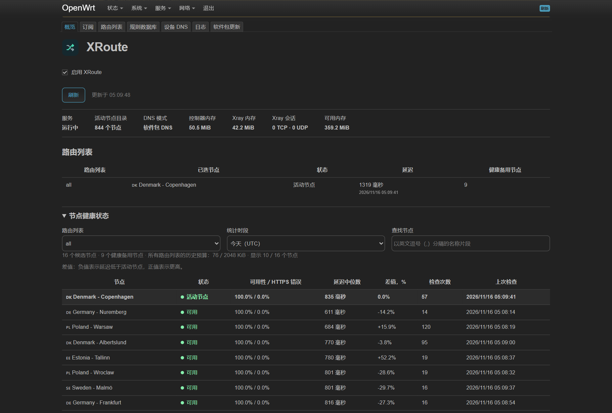
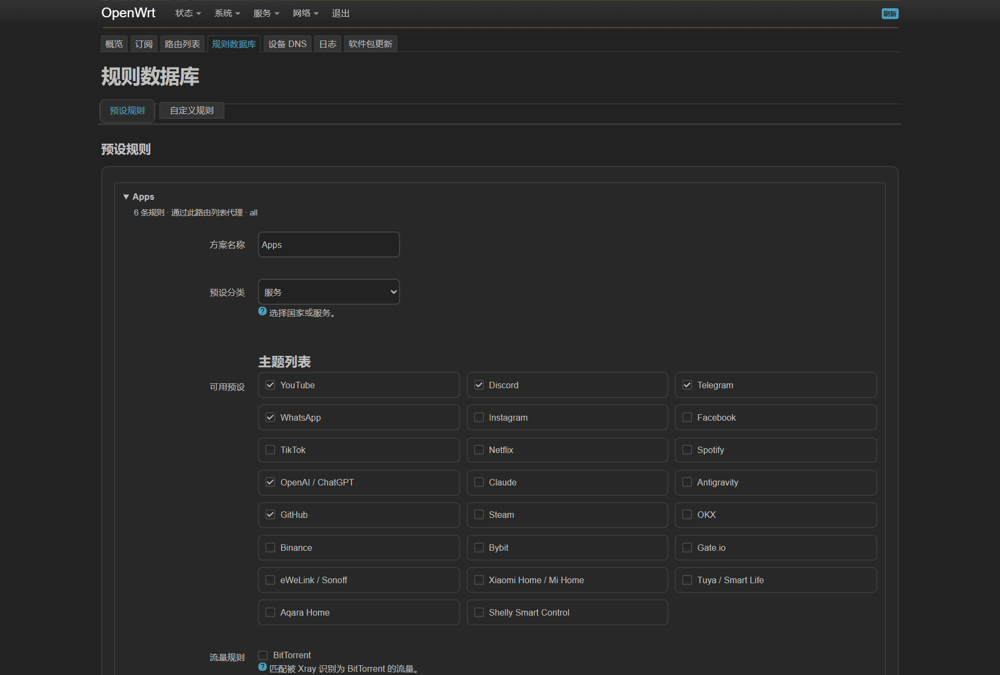
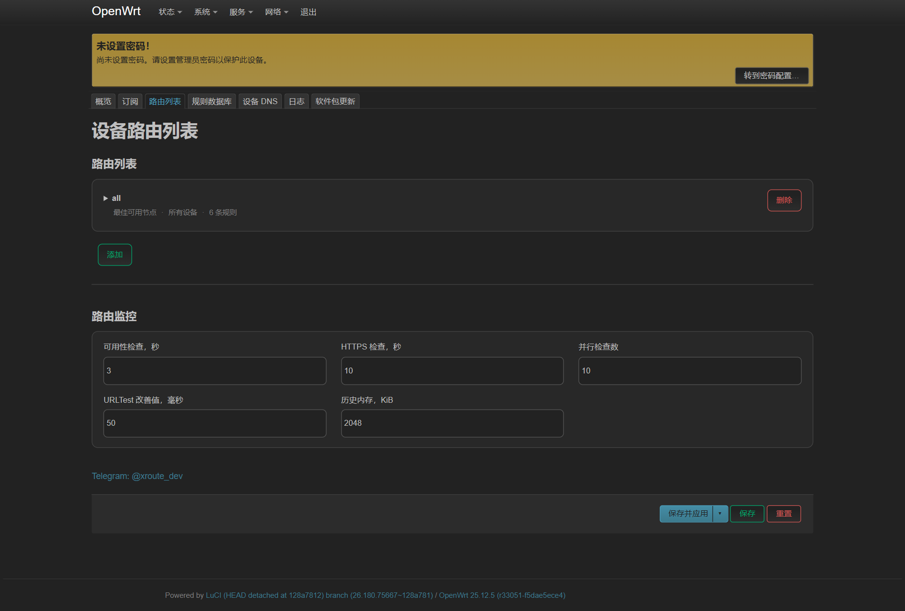
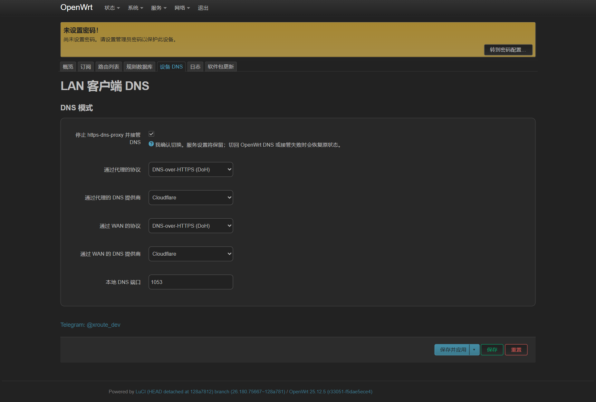

[English](README.md) | [Русский](README-RU.md) | [فارسی](README-FA.md) | [简体中文](README-ZH.md) | [繁體中文](README-ZH-TW.md)


# XRoute for OpenWrt

**[MikroTik RouterOS 7 版本在这里 →](https://github.com/Ati054/xroute)**

我开发 XRoute，是为了通过 LuCI 管理 OpenWrt 上的代理。你可以添加订阅，为设备和网站选择服务器，并设置服务器故障时使用的备用节点。软件包已包含 Xray。

界面支持英语、俄语、简体中文、繁体中文和波斯语。



## 功能

- **订阅：**支持添加多个来源，可使用链接、Clash YAML、sing-box JSON 或 Xray JSON。支持手动或定时更新。下载失败时保留原有节点，更新成功无需重启 Xray。
- **协议：**支持 VLESS、VMess、Trojan、Shadowsocks 和 Hysteria2。可通过界面安装 Shadowsocks SIP003 插件 v2ray-plugin 和 obfs-local。
- **路由列表：**为所有设备、指定 IP 地址或子网分别配置。可从 OpenWrt 静态 DHCP 租约中选择设备，也可手动输入地址。支持按名称、订阅、国家、位置、协议和筛选条件选择节点。
- **名称筛选：**以逗号或 `|` 分隔的片段表示任选其一。双引号表示完整名称匹配：`Sweden, "Amsterdam Premium 01"` 会匹配名称中包含 Sweden 的节点，以及指定的 Amsterdam 节点。排除条件采用相同语法，并且优先于包含条件。
- **URLtest：**按 HTTPS 延迟选择节点。只有两次确认候选节点更快后才会切换，避免因单次延迟突增而更换服务器。可用性检查和故障切换独立运行。
- **优先级与备用：**按指定顺序使用节点；节点故障时切换到备用节点，并在更高优先级节点恢复可用后返回。
- **预设规则：**提供俄罗斯、中国和伊朗的国家规则，以及 YouTube、Discord、Telegram、WhatsApp、社交网络、AI 服务、游戏、交易所和智能家居的服务卡片。每张交易所卡片均包含其网站和 API。
- **自定义规则：**支持域名、IP 网络、端口、TCP/UDP 和识别出的协议。可让流量使用路由列表中的代理或通过 WAN 直连；第一条匹配规则决定路径。
- **所有代理均不可用时：**可为每条规则选择阻断或临时通过 WAN 访问。预设规则和自定义规则可以采用不同的故障处理方式。节点恢复后，流量会重新使用代理。
- **系统协议：**本地地址、VPN 路由和直连 IP 例外优先于 WAN 限制。保留组播、广播及相关 ICMP 错误报文。可阻断通过 WAN 的 Ping；GRE/ESP 在例外范围以外会被阻断。IPv6 直连模式不限制其他协议。
- **DNS：**支持代理及 WAN 解析器、DoH/DoT，并按照设备所属的路由列表和规则处理 DNS 查询。DNS 是否回退至 WAN，遵循对应规则的代理故障设置。外部 DNS 服务正在运行时，会继续由其管理 OpenWrt DNS；接管 https-dns-proxy 需要单独确认。
- **监控：**查看当前节点及备用节点、可用性、延迟和 Delta 差异。将鼠标悬停在 Delta 上可查看两次测量的时间：负值表示更快，正值表示更慢。还可查看进程内存、可用 RAM 和 TCP/UDP 会话数。
- **更新：**可检查 GitHub 并点击按钮安装更新，保留原有设置；也支持手动上传 APK。软件包会使用项目签名密钥进行验证。紧凑更新模式会将 APK 和备份保存在 RAM 中。

更新订阅、切换节点和调整监控间隔均无需重启服务。应用设置时，只要节点仍符合路由列表条件，XRoute 就会保留历史记录和已选节点。

可为每条规则设置代理故障时阻断流量或允许 WAN 访问；服务运行时，DNS 遵循相同规则。直连 IP 例外和 VPN 路由仍然可用。关闭 XRoute、启动失败或服务意外退出时，会移除流量截获并恢复普通 WAN 访问。

更新期间请保持路由器供电。闪存空间不足时，安装器会将软件包备份放在 RAM 中；此时若断电，可能需要重新安装 APK。设置仍保留在路由器上。如需恢复，请按下文说明传送 APK，然后运行 `apk --no-cache add /tmp/xroute.apk`。

## 规则预设



<details>
<summary>路由列表与 DNS 设置</summary>





</details>

## 安装

需要 **采用 APK 的 OpenWrt 25.12，架构为 ARM64 或 x86_64**。可在 `/etc/apk/arch` 中查看软件包架构。

建议至少配备 256 MB RAM。所需闪存空间取决于固件，安装器会在安装前检查。

| 架构 | APK |
|---|---|
| `aarch64_generic` | ARM64 Generic 构建 |
| `aarch64_cortex-a53` | Cortex-A53 / Filogic 构建 |
| `x86_64` | x86-64 构建 |

在电脑终端中运行以下命令，Windows PowerShell 也可以。请将 `192.168.1.1` 替换为路由器的 IP 地址：

```sh
ssh root@192.168.1.1 "wget -O /tmp/xroute-install.sh https://raw.githubusercontent.com/Ati054/xroute-openwrt/main/install.sh && sh /tmp/xroute-install.sh"
```

安装器会识别架构、检查可用空间、下载最新稳定版、验证 APK 签名及 SHA-256，并安装依赖项。

### 路由器无法访问 GitHub 时

1. 查看架构：`ssh root@192.168.1.1 "cat /etc/apk/arch"`。
2. 从 [Releases](https://github.com/Ati054/xroute-openwrt/releases) 下载匹配的 APK 和[安装脚本](https://raw.githubusercontent.com/Ati054/xroute-openwrt/main/install.sh)，在同一文件夹中分别保存为 `xroute.apk` 和 `install.sh`。
3. 在该文件夹中打开 PowerShell，运行：

   ```powershell
   scp -O .\xroute.apk .\install.sh root@192.168.1.1:/tmp/
   ssh root@192.168.1.1 "sh /tmp/install.sh --local /tmp/xroute.apk"
   ```

`-O` 使用与 Dropbear 兼容的 SCP 方式。安装前，安装器会使用固定的项目密钥验证 APK。缺少的依赖项仍需从 OpenWrt 软件仓库获取。

### 配置

首次安装后，服务默认关闭。在 LuCI 中打开**服务 → XRoute**：

1. 在服务仍关闭时添加订阅并下载节点。
2. 创建规则和路由列表，再选择设备与节点。
3. 配置 DNS，启用 XRoute，保存并应用设置。

订阅没有节点数量上限。导入时，XRoute 会检查数据大小和可用空间。

仅为已关联到路由列表的规则下载数据库。稍后添加规则并应用设置时，会自动下载缺少的数据库。概览页显示下载进度和错误。

从 PassWall2 切换时，请先在**系统 → 启动项**中停止 PassWall2 并关闭其开机自启，再启用 XRoute。XRoute 关闭期间即可准备订阅和规则。未设置覆盖所有设备的列表时，其他地址继续使用 WAN。

受控启动或重启期间，临时保护遵循设置中的 WAN 权限。致命错误、启动超时或服务意外退出时，会移除流量截获并恢复之前的 DNS 配置。在服务再次就绪前，包括严格列表在内的所有 LAN 客户端均使用普通 WAN。服务运行期间单个代理节点故障时，仍按规则选择阻断或 WAN 访问。

更新时，打开**软件包更新 → 检查更新 → 从 GitHub 更新**。检查只获取版本信息；再次点击**从 GitHub 更新**后才开始下载和安装。可以跳过中间版本。设置及服务的启用或关闭状态会保留；原本运行中的服务会在更新期间重启。

计数器说明及问题报告所需的命令见 [DNS 诊断](docs/DNS-DIAGNOSTICS.en.md)。

## 构建

使用适合目标 ARM64 或 x86/64 平台的 OpenWrt 25.12 SDK 和 Go 1.27.4。将仓库放在 `SDK/package/resproxy`，然后运行：

```sh
make -C SDK/package/resproxy TOPDIR=/absolute/path/to/SDK compile V=s
```

依赖项包含在 `vendor` 中，内核源码位于 `third_party/xray-core`。

## 许可证

本项目采用 AGPL-3.0。内核及依赖项的许可证保留在 [LICENSE](LICENSE)、[NOTICE.md](NOTICE.md)、`vendor` 和 `third_party` 中。

## 常见问题

**是否可以仅让指定网站或设备通过代理？**

可以。添加订阅，创建动作为代理的服务、域名或 IP 规则，再将规则关联到所需设备的路由列表。
如果其他流量需要保持直连，将其设为 WAN。
MikroTik RouterOS 7 请使用 [MikroTik 版本及其网页界面配置说明](https://github.com/Ati054/xroute)。

**XRoute 与 Podkop、PassWall2 有什么区别？**

[Podkop](https://github.com/itdoginfo/podkop/blob/main/README.md) 使用 sing-box。
[PassWall2](https://github.com/Openwrt-Passwall/openwrt-passwall2/blob/main/README.md) 支持多种代理内核及相关软件包。
XRoute 包含一个 Xray 内核，通过 LuCI 界面管理订阅、路由列表、节点选择和 DNS。
此软件包适用于采用 APK 的 OpenWrt 25.12，支持 ARM64 和 x86_64。

## 社区

[Telegram: @xroute_dev](https://t.me/xroute_dev)
