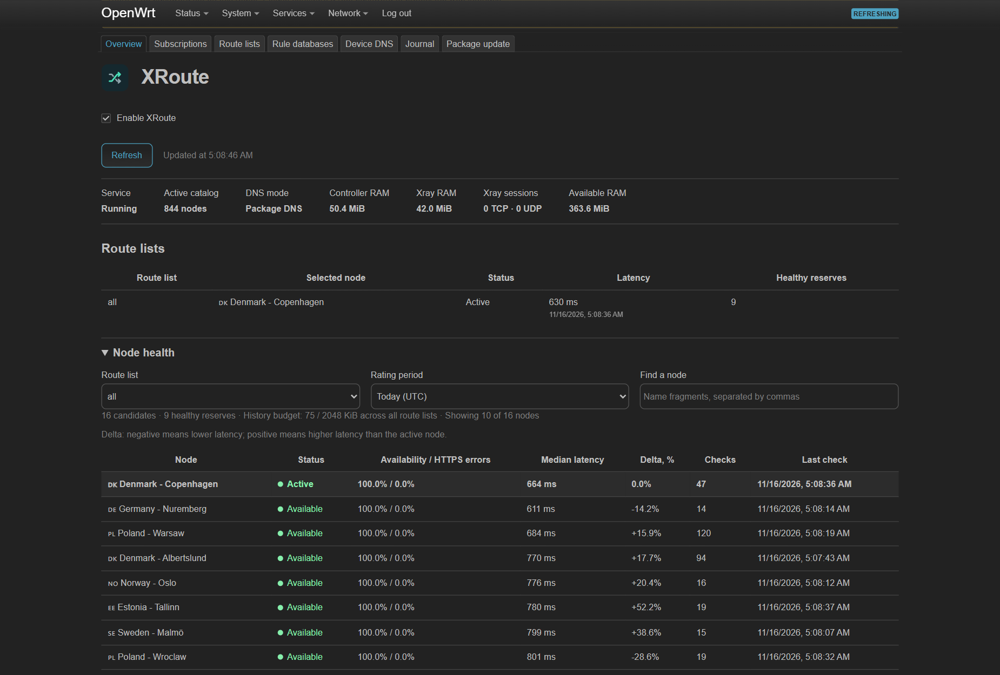
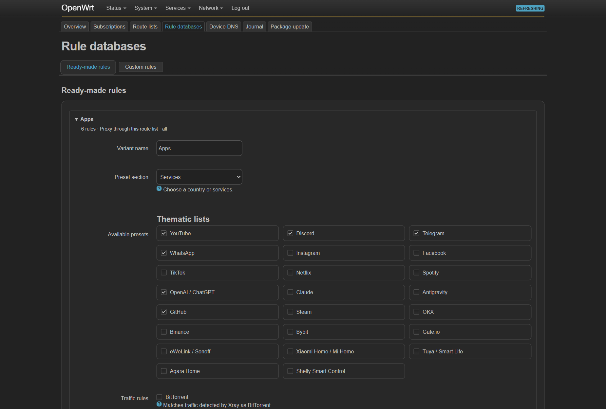
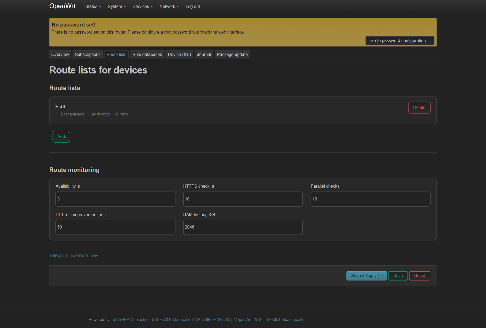
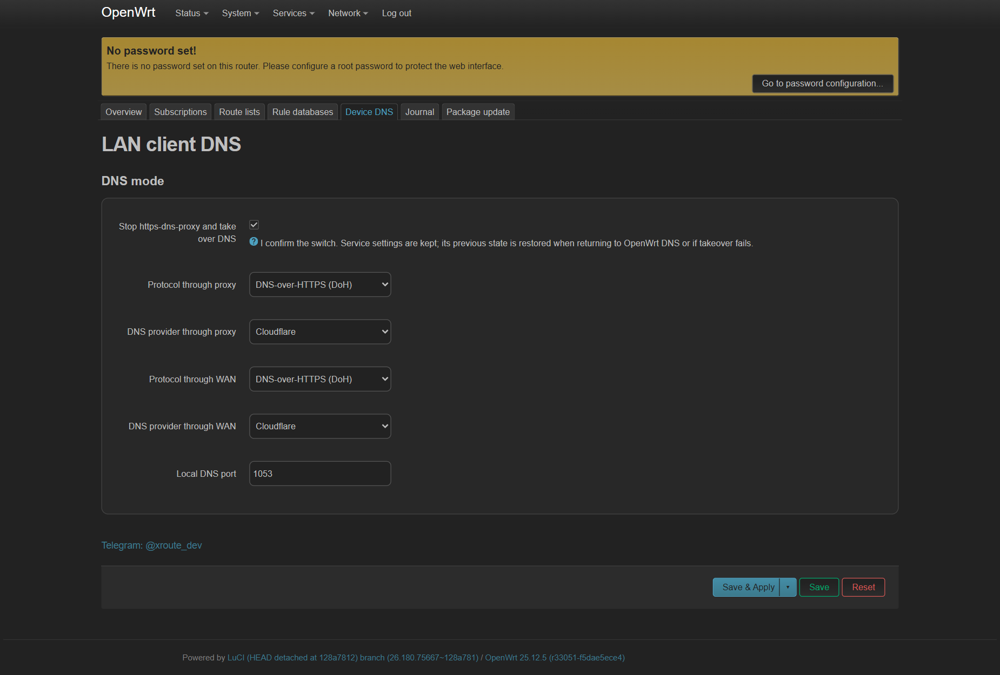

[English](README.md) | [Русский](README-RU.md) | [فارسی](README-FA.md) | [简体中文](README-ZH.md) | [繁體中文](README-ZH-TW.md)


# XRoute for OpenWrt

**[MikroTik RouterOS7 version here →](https://github.com/Ati054/xroute)**

I made XRoute to manage proxies on OpenWrt from LuCI. You can add subscriptions, choose servers for devices and websites, and set up a backup for server failures. Xray is included in the package.

You can use the interface in English, Russian, Simplified or Traditional Chinese, and Persian.



## Features

- **Subscriptions:** add multiple sources with links, Clash YAML, sing-box JSON, or Xray JSON. Update them by hand or on a schedule. Failed downloads leave the previous nodes in place; successful updates do not require an Xray restart.
- **Protocols:** VLESS, VMess, Trojan, Shadowsocks, and Hysteria2. Shadowsocks SIP003 plugins v2ray-plugin and obfs-local can be installed from the interface.
- **Route lists:** separate settings for all devices, selected IP addresses, or subnets. Pick devices from OpenWrt static DHCP reservations or enter addresses manually. Select nodes by name, subscription, country, location, protocol, and filters.
- **Name filters:** comma-separated or `|`-separated fragments are alternatives. Double quotes require a full name: `Sweden, "Amsterdam Premium 01"` matches names containing Sweden and the specific Amsterdam node. Exclusion uses the same syntax and takes precedence.
- **URLtest:** choose a node by HTTPS latency. Switching requires two confirmations of an improvement to avoid changing servers after a single latency spike. Availability checks and failover run separately.
- **Priority / reserve:** uses nodes in the specified order, falls back when a node fails, and returns to an available node with higher priority.
- **Presets:** country rules for Russia, China, and Iran; service cards for YouTube, Discord, Telegram, WhatsApp, social networks, AI services, games, exchanges, and smart homes. Each exchange card includes its website and API.
- **Custom rules:** domains, IP networks, ports, TCP/UDP, and detected protocols. Send traffic through the route list's proxy or directly through WAN; the first matching rule determines the route.
- **All proxies unavailable:** choose blocking or temporary WAN access in each rule. You can set different actions for presets and custom rules. Traffic returns to the proxy when a node recovers.
- **System protocols:** local addresses, VPN routes, and direct IP exceptions take precedence over WAN restrictions. Multicast, broadcast, and related ICMP errors are preserved. WAN ping can be blocked; GRE/ESP are blocked outside exceptions. IPv6 direct mode does not restrict other protocols.
- **DNS:** proxy and WAN resolvers, DoH/DoT, and device queries handled according to their route list and rules. DNS WAN fallback follows the rule’s proxy failure setting. An active external DNS service keeps OpenWrt DNS; handing over https-dns-proxy requires separate confirmation.
- **Monitoring:** view the active node and backups, availability, latency, and the Delta comparison. Hover over Delta to see both measurement times: negative means faster and positive means slower. You can also check process memory, available RAM, and TCP/UDP session counts.
- **Updates:** check GitHub and install with a button while preserving settings; manual APK upload is also available. Packages are verified against the project signing key. Compact updates keep the APK and backup in RAM.

Update subscriptions, switch nodes, and change monitoring intervals without restarting the service. XRoute keeps history and the selected node when you apply settings, provided the node still matches the route list.

Choose blocking or WAN access for each rule if its proxy fails. DNS follows the same rule while the service runs. Direct IP exceptions and VPN routes remain available. Turning XRoute off, a failed startup or an unplanned service exit removes interception and restores ordinary WAN access.

Keep the router powered during an update. If flash space is low, the installer keeps its package backup in RAM. A power interruption at that point may require reinstalling the APK. Your settings remain on the router. To recover, transfer the APK using the instructions below and run `apk --no-cache add /tmp/xroute.apk`.

## Rule presets



<details>
<summary>Route lists and DNS settings</summary>





</details>

## Installation

You need **OpenWrt 25.12 with APK, ARM64 or x86_64**. Check the package architecture in `/etc/apk/arch`.

At least 256 MB RAM is recommended. Available flash space depends on the firmware; the installer checks it before installation.

| Architecture | APK |
|---|---|
| `aarch64_generic` | ARM64 Generic build |
| `aarch64_cortex-a53` | Cortex-A53 / Filogic build |
| `x86_64` | x86-64 build |

Run this in a terminal on your PC, including Windows PowerShell. Replace `192.168.1.1` with your router's IP address:

```sh
ssh root@192.168.1.1 "wget -O /tmp/xroute-install.sh https://raw.githubusercontent.com/Ati054/xroute-openwrt/main/install.sh && sh /tmp/xroute-install.sh"
```

The installer detects the architecture, checks available space, downloads the latest stable version, verifies the APK signature and SHA-256, and installs dependencies.

### If the router cannot access GitHub

1. Check its architecture: `ssh root@192.168.1.1 "cat /etc/apk/arch"`.
2. Download the matching APK from [Releases](https://github.com/Ati054/xroute-openwrt/releases) and the [installer](https://raw.githubusercontent.com/Ati054/xroute-openwrt/main/install.sh). Save them in one folder as `xroute.apk` and `install.sh`.
3. Open PowerShell in that folder and run:

   ```powershell
   scp -O .\xroute.apk .\install.sh root@192.168.1.1:/tmp/
   ssh root@192.168.1.1 "sh /tmp/install.sh --local /tmp/xroute.apk"
   ```

`-O` uses SCP with Dropbear. The installer checks the APK against the pinned project key before installation. OpenWrt repositories are still needed for missing dependencies.

### Setup

The service is disabled after the first installation. Open **Services → XRoute** in LuCI:

1. Add subscriptions and download nodes while the service is still disabled.
2. Create rules and route lists, then select devices and nodes.
3. Configure DNS, enable XRoute, save, and apply settings.

There is no node-count cap for subscriptions. XRoute checks data size and available space during import.

Databases are downloaded for rules attached to route lists. Attach a rule later and apply the settings to load its missing databases automatically. Download progress and errors appear on the overview page.

When switching from PassWall2, stop it and disable its autostart in **System → Startup** before enabling XRoute. Subscriptions and rules can be prepared while XRoute is disabled. Without an all-device list, other addresses continue to use WAN.

During a controlled startup or restart, the temporary guard follows the configured WAN permissions. A fatal error, startup timeout or unplanned exit removes interception and restores the previous DNS configuration. All LAN clients then use ordinary WAN, including strict lists, until the service becomes ready again. A proxy-node outage while the service runs still follows each rule's block/WAN action.

To update, open **Package update → Check for updates → Update from GitHub**. Checking only fetches version information; download and installation start after a separate click on **Update from GitHub**. You can skip intermediate versions. Settings and the service's enabled or disabled state are preserved; a running service restarts during the update.

See [DNS diagnostics](docs/DNS-DIAGNOSTICS.en.md) for counters and commands to include in a problem report.

`resproxyd doctor` checks firewall capabilities without changing the network and reports the last saved service incident. See [firmware compatibility and recovery](docs/FIRMWARE-COMPATIBILITY.md) for the tested scope.

## Building

Use the OpenWrt 25.12 SDK for your ARM64 or x86/64 target and Go 1.27.4. Place the repository in `SDK/package/resproxy` and run:

```sh
make -C SDK/package/resproxy TOPDIR=/absolute/path/to/SDK compile V=s
```

Dependencies are included in `vendor`; the core source is in `third_party/xray-core`.

## Licenses

The project uses AGPL-3.0. Core and dependency licenses are preserved in [LICENSE](LICENSE), [NOTICE.md](NOTICE.md), `vendor`, and `third_party`.

## FAQ

**Can I proxy only selected websites or devices?**

Yes. Add a subscription, create a service, domain, or IP rule with the proxy action, and attach it to a route list for the required devices. Set other traffic to WAN if it should remain direct. For MikroTik RouterOS 7, use the [MikroTik version and its Web interface setup](https://github.com/Ati054/xroute).

**How does XRoute differ from Podkop and PassWall2?**

[Podkop](https://github.com/itdoginfo/podkop/blob/main/README.md) uses sing-box. [PassWall2](https://github.com/Openwrt-Passwall/openwrt-passwall2/blob/main/README.md) supports several proxy cores and related packages. XRoute includes one Xray core and manages subscriptions, route lists, node selection, and DNS in its LuCI interface. This package targets OpenWrt 25.12 with APK on ARM64 and x86_64.

## Community

[Telegram: @xroute_dev](https://t.me/xroute_dev)
