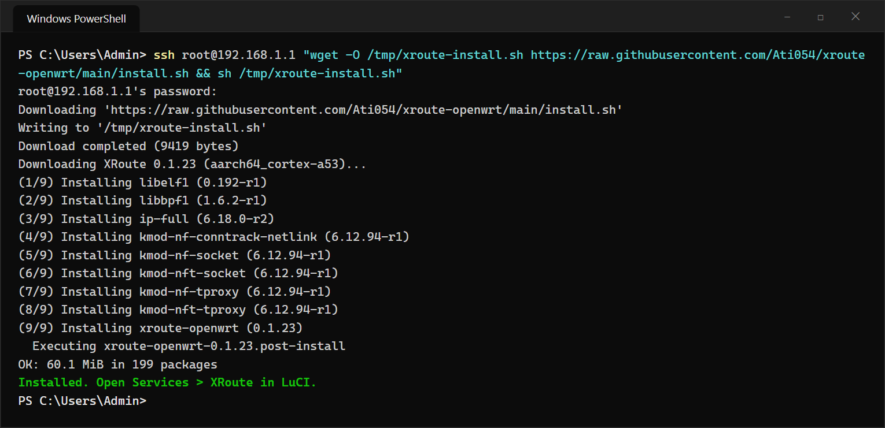
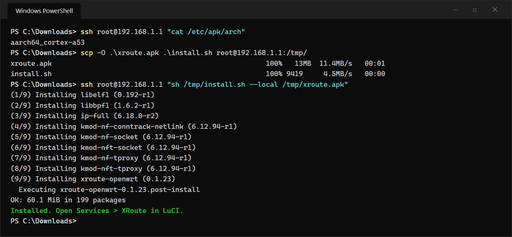
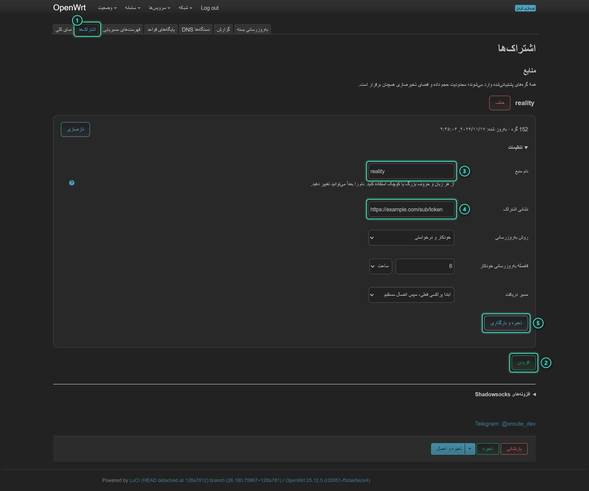
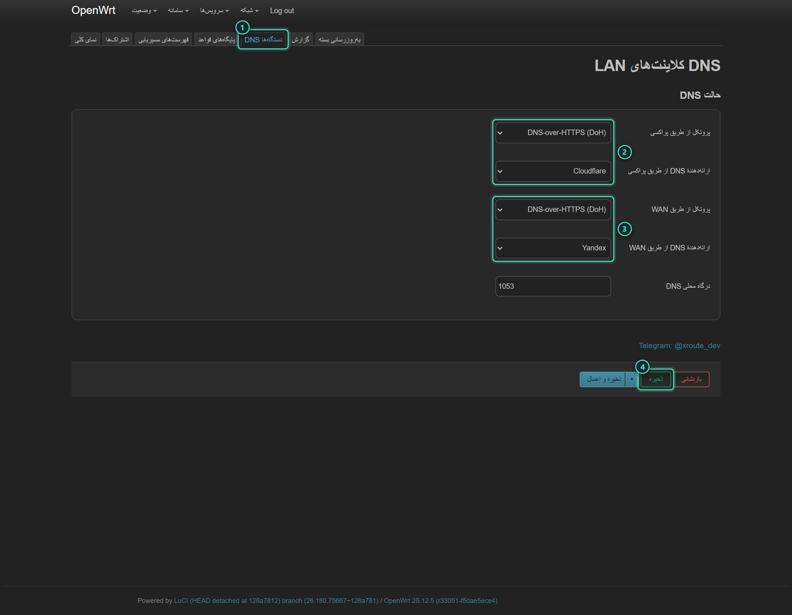
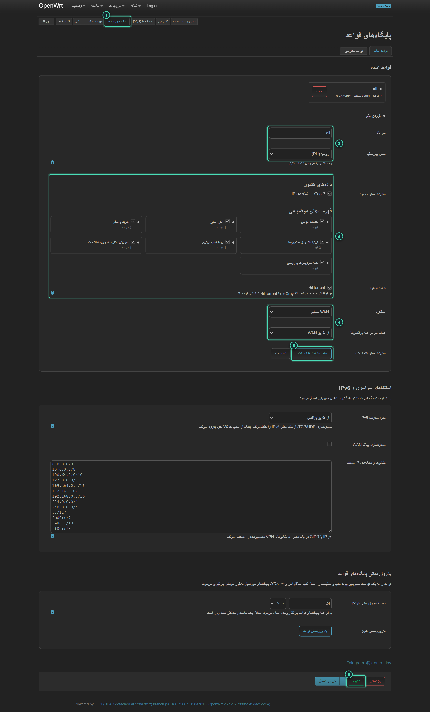
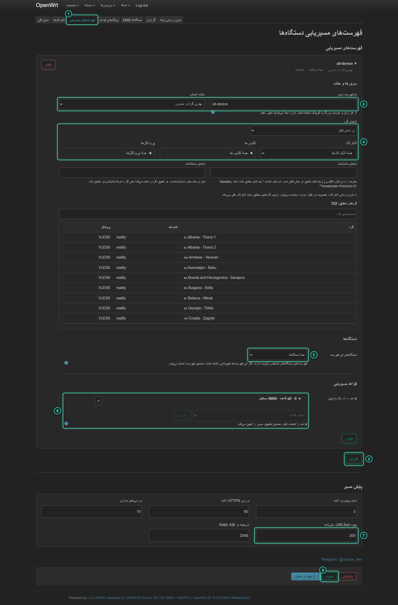
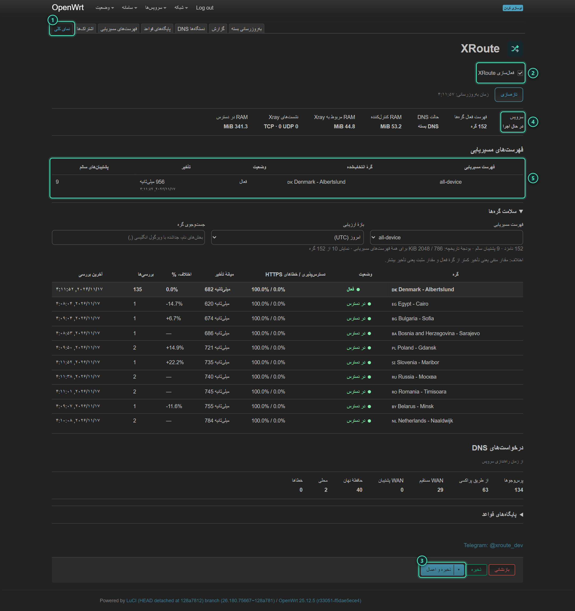

[English](SETUP.md) | [Русский](SETUP-RU.md) | [فارسی](SETUP-FA.md) | [简体中文](SETUP-ZH.md) | [繁體中文](SETUP-ZH-TW.md)

<div dir="rtl">

# نصب و راه‌اندازی XRoute روی OpenWrt 25.12

راهنمای گام‌به‌گام راه‌اندازی اولیه برای روترهای **OpenWrt 25.12** با مدیر بستهٔ `APK` (معماری‌های `aarch64_generic`، ‏`aarch64_cortex-a53` و `x86_64`، ۲۵۶ مگابایت RAM پیشنهادی).

نصاب آخرین نسخهٔ پایدار را دریافت می‌کند. نسخه و تعداد گره‌های تصاویر نمونه هستند.

## نصب بسته

در رایانهٔ خود یک ترمینال باز کنید (برای نمونه **Windows PowerShell**). در دستورهای زیر به جای `192.168.1.1` نشانی IP روتر خود را قرار دهید.

### روش ۱. دسترسی مستقیم روتر به GitHub

یک دستور را اجرا کنید. اسکریپت به صورت خودکار معماری روتر، فضای خالی و امضای نسخه را بررسی می‌کند و بسته را به همراه وابستگی‌های هسته نصب می‌کند:

<div dir="ltr">

```powershell
ssh root@192.168.1.1 "wget -O /tmp/xroute-install.sh https://raw.githubusercontent.com/Ati054/xroute-openwrt/main/install.sh && sh /tmp/xroute-install.sh"
```

</div>



### روش ۲. عدم دسترسی روتر به GitHub

1. معماری بسته‌های روتر را بررسی کنید:

   <div dir="ltr">

   ```powershell
   ssh root@192.168.1.1 "cat /etc/apk/arch"
   ```

   </div>

2. فایل `.apk` متناسب با معماری روتر (نام آن را به `xroute.apk` تغییر دهید) و فایل `install.sh` را از صفحهٔ [Releases](https://github.com/Ati054/xroute-openwrt/releases) در یک پوشه روی رایانه ذخیره کنید.

3. در همان پوشه PowerShell را باز کنید، فایل‌ها را به روتر بفرستید و نصب محلی را اجرا کنید:

   <div dir="ltr">

   ```powershell
   scp -O .\xroute.apk .\install.sh root@192.168.1.1:/tmp/
   ssh root@192.168.1.1 "sh /tmp/install.sh --local /tmp/xroute.apk"
   ```

   </div>

   مخازن رسمی خود OpenWrt باید روی روتر در دسترس باشند تا `apk` بتواند ماژول‌های سیستمی `kmod-nft-tproxy` را دریافت کند.



پس از نمایش پیام `Installed. Open Services > XRoute in LuCI.` صفحهٔ وب روتر را نوسازی کنید و به **سرویس‌ها ← XRoute** بروید.

> [!IMPORTANT]
> بلافاصله پس از نصب، سرویس غیرفعال است و گزینهٔ فعال‌سازی تا زمان ساخت اشتراک و فهرست مسیریابی قفل می‌ماند. زبانه‌های زیر را به ترتیب طی کنید و در گام آخر XRoute را روشن کنید.

اگر از PassWall2 یا HomeProxy استفاده می‌کنید، پیش از فعال‌سازی XRoute آن را متوقف کنید و اجرای خودکارش را در **سیستم ← راه‌اندازی** غیرفعال کنید.

## گام ۱. اشتراک‌ها

1. زبانهٔ **اشتراک‌ها** (`1`) را باز کنید.
2. روی **افزودن** (`2`) کلیک کنید.
3. در بخش **نام منبع** (`3`) یک نام به دلخواه و به هر زبانی وارد کنید (مثلاً `اشتراک من` یا `reality`).
4. پیوند `https://` اشتراک خود را در **نشانی اشتراک** (`4`) قرار دهید.
5. روی **ذخیره و بارگذاری** (`5`) کلیک کنید و صبر کنید تا شمارندهٔ سرورهای واردشده نمایان شود (`152 گره`).



## گام ۲. DNS دستگاه‌ها

1. زبانهٔ **DNS دستگاه‌ها** (`1`) را باز کنید.
2. حل‌کنندهٔ **از طریق پراکسی** (`2`) را انتخاب کنید، برای نمونه `DNS-over-HTTPS (DoH)` و `Cloudflare`.
3. حل‌کنندهٔ **از طریق WAN** (`3`) را انتخاب کنید که بدون پراکسی پاسخ می‌دهد. در تصویر، `DoH` و `Yandex` نمونه‌ای برای روسیه هستند. گزینهٔ `DNS ارائه‌دهندهٔ اینترنت` از نشانی‌های DNS دریافتی از ارائه‌دهنده استفاده می‌کند؛ این گزینه DoH نیست.
4. روی **ذخیره** (`4`) کلیک کنید. اگر روی روتر `https-dns-proxy` فعال باشد، گزینهٔ تأیید واگذاری DNS نیز در بالای صفحه دیده می‌شود؛ پیش از ذخیره آن را علامت بزنید.



## گام ۳. پایگاه‌های قواعد

در این نمونه، قواعد کشوری انتخاب‌شده و BitTorrent از WAN و بقیهٔ ترافیک از پراکسی عبور می‌کنند. تصاویر قواعد روسیه (RU) را نشان می‌دهند؛ کشور موردنیاز خود را انتخاب کنید.

1. به **پایگاه‌های قواعد** (`1`) ← **قواعد آماده** بروید و بخش **افزودن الگو** را باز کنید.
2. یک **نام الگو** (مثلاً `all`) بنویسید و **بخش پیش‌تنظیم** (`2`) را انتخاب کنید، مانند `ایران (IR)`، ‏`روسیه (RU)`، ‏`چین (CN)` یا `سرویس‌ها`.
3. دسته‌های موردنظر و در صورت نیاز گزینهٔ **BitTorrent** (`3`) را علامت بزنید.
4. **عملکرد** (`WAN مستقیم` برای استثناهای مستقیم یا `پراکسی از طریق این فهرست مسیریابی` برای سرویس‌های پراکسی‌شده) و گزینهٔ **هنگام خرابی همهٔ پراکسی‌ها** (`4`) را بررسی کنید: به طور پیش‌فرض روی `از طریق WAN` قرار دارد تا در صورت از کار افتادن همهٔ سرورها اینترنت عادی قطع نشود. اگر برای قوانین پراکسی به مسدودسازی سخت‌گیرانه نیاز دارید، گزینهٔ `مسدودسازی` را انتخاب کنید.
5. روی **ساخت قواعد انتخاب‌شده** (`5`) کلیک کنید تا کارت مجموعه در بالای بخش ثبت شود.
6. در پایین صفحه روی **ذخیره** (`6`) کلیک کنید.



## گام ۴. فهرست‌های مسیریابی

فهرست مسیریابی، دستگاه‌های شبکه، گره‌های اشتراک و قوانین را به هم وصل می‌کند:

1. زبانهٔ **فهرست‌های مسیریابی** (`1`) را باز کنید و **افزودن** (`2`) را بزنید.
2. **نام فهرست مسیر** را به هر زبانی وارد کنید (مثلاً `دستگاه‌های خانه` یا `all-device`) و **حالت انتخاب** (`3`) را مشخص کنید: `بهترین گرهٔ در دسترس` (انتخاب خودکار بر پایهٔ تأخیر HTTPS `URLTest`) یا `اولویت / پشتیبان` (ترتیب ثابت با بازگشت خودکار).
3. در بخش **انتخاب گره** (`4`) ساده‌ترین حالت برای شروع `بر اساس فیلتر` با `همهٔ اشتراک‌ها`، ‏`همهٔ کشورها` و `همهٔ پروتکل‌ها` است. کادرهای فیلتر نام را خالی بگذارید تا همهٔ گره‌های اشتراک انتخاب شوند، یا برای گزینش دستی شهرها و سرورها حالت `انتخاب مکان‌ها` را برگزینید.
4. در **دستگاه‌های این فهرست** (`5`) گزینهٔ `همهٔ دستگاه‌ها` را بگذارید (یا برای IPهای مشخص در شبکه، `دستگاه‌های انتخاب‌شده` را انتخاب کنید).
5. در بخش **قواعد مسیریابی** (`6`) الگوی ساخته‌شده در گام قبل (مثلاً `all`) را از فهرست انتخاب کرده و `افزودن` را بزنید.
6. در **پایش مسیر**، مقدار **بهبود URLTest، میلی‌ثانیه** (`7`) را روی پیش‌فرض `50` نگه دارید یا مانند تصویر `200` وارد کنید. با افزایش این مقدار، تعویض گره به بهبود بیشتری در تأخیر نیاز دارد.
7. در پایین صفحه روی **ذخیره** (`8`) کلیک کنید.



## گام ۵. فعال‌سازی و بررسی وضعیت

1. به زبانهٔ **نمای کلی** (`1`) بروید.
2. تیک **فعال‌سازی XRoute** (`2`) را بزنید.
3. در پایین صفحه روی **ذخیره و اعمال** (`3`) کلیک کنید.
4. صبر کنید تا **سرویس** به `در حال اجرا` (`4`) تغییر کند و گرهٔ انتخاب‌شده با وضعیت `فعال` (`5`) نمایش داده شود. در اولین اجرا، XRoute پایگاه‌های قواعد متصل‌شده را هم دریافت می‌کند؛ این کار ممکن است بیش از ۳۰ ثانیه طول بکشد. بررسی‌ها و تأخیرها را در **سلامت گره‌ها** و شمارنده‌های DNS را در **درخواست‌های DNS** ببینید.



</div>
