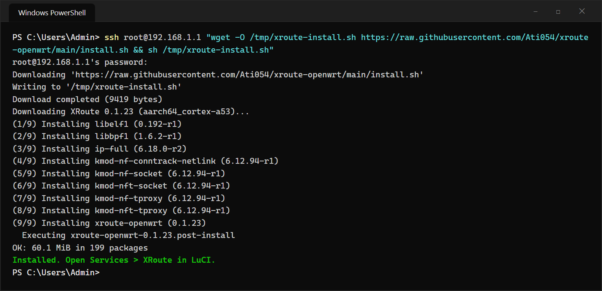
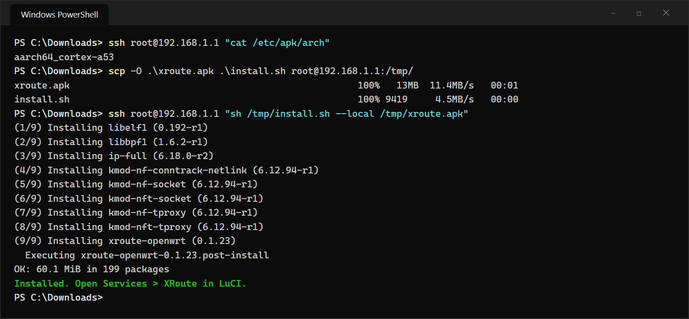
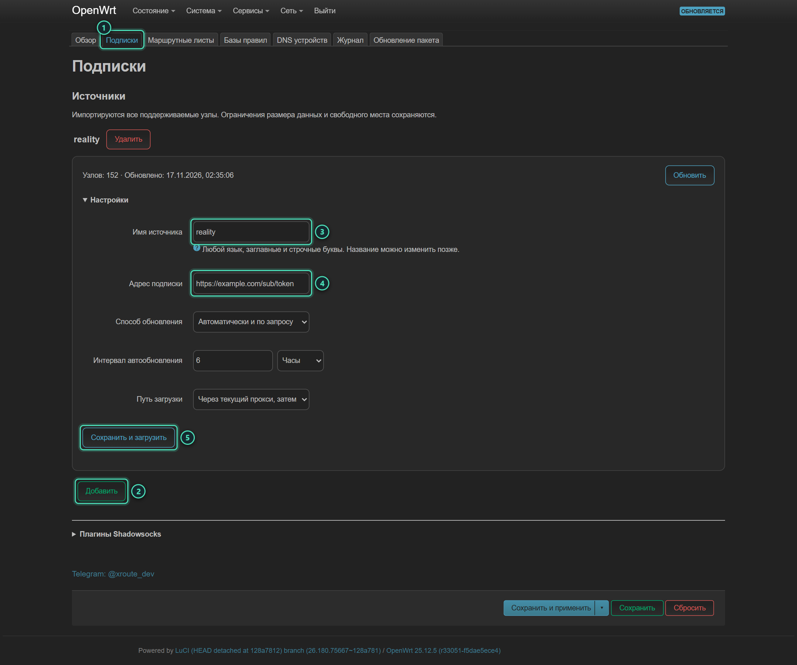
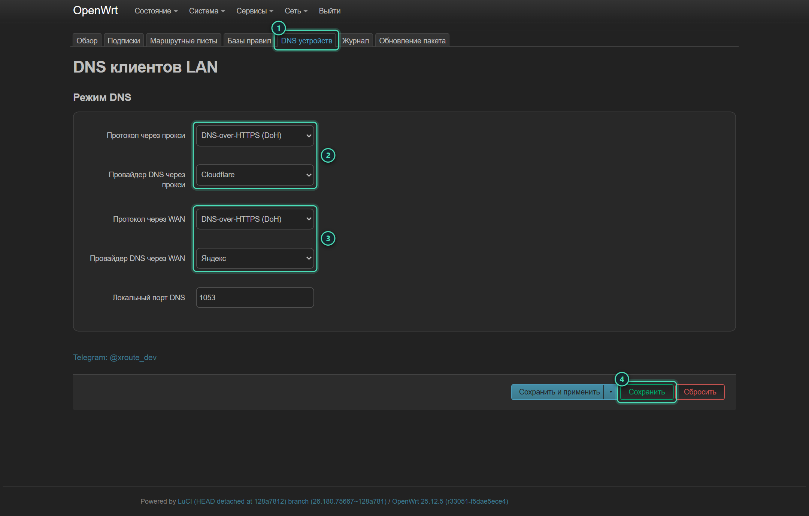
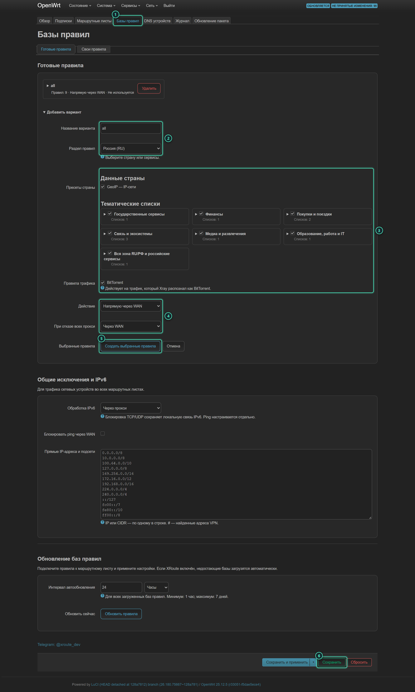
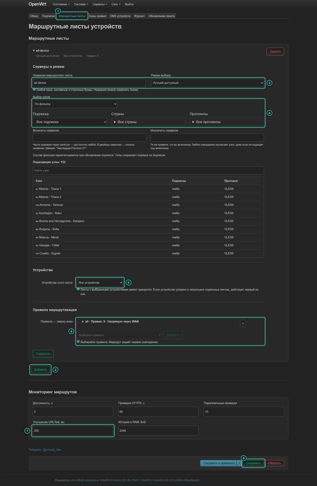
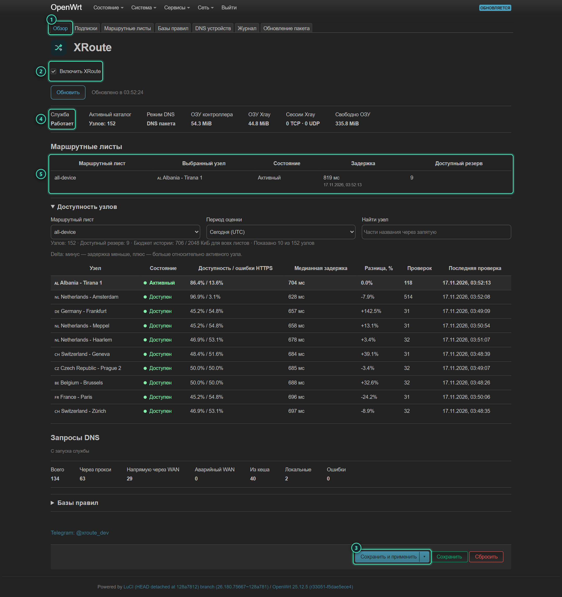

[English](SETUP.md) | [Русский](SETUP-RU.md) | [فارسی](SETUP-FA.md) | [简体中文](SETUP-ZH.md) | [繁體中文](SETUP-ZH-TW.md)

# Установка и настройка XRoute на OpenWrt 25.12

Пошаговая настройка с нуля для роутеров на **OpenWrt 25.12** с пакетным менеджером `APK` (`aarch64_generic`, `aarch64_cortex-a53`, `x86_64`, рекомендуется от 256 МБ ОЗУ).

Установщик скачивает последний стабильный релиз. Версия и число узлов на скриншотах приведены для примера.

## Установка пакета

Откройте терминал на компьютере (например, **Windows PowerShell**). В командах ниже подставьте адрес вашего роутера вместо `192.168.1.1`.

### Вариант 1. С роутера открывается GitHub

Выполните одну команду. Скрипт сам определит архитектуру, проверит свободное место, подпись релиза и поставит пакет со всеми зависимостями:

```powershell
ssh root@192.168.1.1 "wget -O /tmp/xroute-install.sh https://raw.githubusercontent.com/Ati054/xroute-openwrt/main/install.sh && sh /tmp/xroute-install.sh"
```



### Вариант 2. GitHub на роутере недоступен

1. Посмотрите архитектуру пакетов на роутере:
   ```powershell
   ssh root@192.168.1.1 "cat /etc/apk/arch"
   ```
2. Скачайте на компьютер со страницы [Releases](https://github.com/Ati054/xroute-openwrt/releases) подходящий `.apk` файл (переименуйте его в `xroute.apk`) и скрипт `install.sh` в одну папку.
3. Откройте PowerShell в этой папке, скопируйте файлы на роутер и запустите установку:
   ```powershell
   scp -O .\xroute.apk .\install.sh root@192.168.1.1:/tmp/
   ssh root@192.168.1.1 "sh /tmp/install.sh --local /tmp/xroute.apk"
   ```
   Репозитории самой OpenWrt на роутере должны быть доступны, чтобы `apk` докачал системные модули `kmod-nft-tproxy`.



После появления строки `Installed. Open Services > XRoute in LuCI.` обновите веб-интерфейс роутера и зайдите в **Сервисы → XRoute**.

> [!IMPORTANT]
> Сразу после установки служба выключена, а галочка запуска заблокирована, пока не готовы подписка и маршрутный лист. Пройдите вкладки ниже по порядку и включайте XRoute на последнем шаге.

Если используете PassWall2 или HomeProxy, перед включением XRoute остановите его и отключите автозапуск в **Система → Автозагрузка**.

## Шаг 1. Подписки

1. Откройте вкладку **Подписки** (`1`).
2. Нажмите **Добавить** (`2`).
3. Впишите **Имя источника** (`3`) на любом языке (например, `Моя подписка` или `reality`).
4. Вставьте `https://` ссылку в поле **Адрес подписки** (`4`).
5. Нажмите **Сохранить и загрузить** (`5`) и дождитесь появления счетчика импортированных серверов (`Узлов: ...`).



## Шаг 2. DNS устройств

1. Откройте вкладку **DNS устройств** (`1`).
2. Выберите резолвер **через прокси** (`2`), например `DNS-over-HTTPS (DoH)` и `Cloudflare`.
3. Выберите резолвер **через WAN** (`3`), который отвечает без прокси. На скриншоте пример для РФ: `DNS-over-HTTPS (DoH)` и `Яндекс`. Можно выбрать `DNS провайдера WAN`: он использует DNS-адреса, полученные от провайдера, а не DoH.
4. Нажмите **Сохранить** (`4`). Если на роутере запущен сторонний `https-dns-proxy`, сверху также появится галочка подтверждения перехвата DNS, отметьте её.



## Шаг 3. Базы правил

В этом примере выбранные российские сайты, банки и BitTorrent идут через WAN, остальной трафик через прокси. Набор правил затем нужно прикрепить к маршрутному листу.

1. Откройте вкладку **Базы правил** (`1`) → **Готовые правила** и раскройте **Добавить вариант**.
2. Впишите **Название варианта** (например, `all`) и выберите **Раздел правил** (`2`). В примере выбрана `Россия (RU)`; доступны также Китай, Иран и `Сервисы`.
3. Отметьте нужные категории и при необходимости галочку **BitTorrent** (`3`).
4. Проверьте **Действие** (`Напрямую через WAN` для прямых исключений или `Через прокси этого маршрутного листа` для проксируемых сервисов) и пункт **При отказе всех прокси** (`4`): по умолчанию стоит `Через WAN`, чтобы при отказе всех выбранных узлов не пропадал обычный интернет. Если для прокси-правил нужен строгий запрет выхода мимо прокси, переключите на `Блокировать`.
5. Нажмите **Создать выбранные правила** (`5`). Сверху появится карточка созданного набора.
6. Нажмите **Сохранить** (`6`) внизу страницы.



## Шаг 4. Маршрутные листы

Маршрутный лист связывает устройства домашней сети, серверы подписки и правила:

1. Откройте вкладку **Маршрутные листы** (`1`) и нажмите **Добавить** (`2`).
2. Заполните **Название маршрутного листа** на любом языке (например, `Домашние устройства` или `all-device`) и выберите **Режим выбора** (`3`): `Лучший доступный` (автовыбор по задержке HTTPS `URLTest`) или `Приоритет / резерв` (строгий список с автовозвратом).
3. В блоке **Выбор узлов** (`4`) для старта проще всего поставить `По фильтру`, оставив `Все подписки`, `Все страны` и `Все протоколы`. Поля фильтра по названиям ниже можно оставить пустыми, тогда подтянутся все серверы подписки. Если нужны конкретные локации, переключите на `Выбрать локации`.
4. В поле **Устройства этого листа** (`5`) выберите `Все устройства` (или `Выбранные устройства`, если настраиваете маршрут под отдельные IP в сети).
5. В блоке **Правила маршрутизации** (`6`) выберите из списка созданный набор (например, `all`) и нажмите `Добавить`.
6. В блоке **Мониторинг маршрутов** оставьте **Улучшение URLTest, мс** (`7`) равным `50` или укажите `200`, как на скриншоте. Чем выше порог, тем больший выигрыш по задержке нужен для переключения.
7. Нажмите **Сохранить** (`8`) внизу страницы.



## Шаг 5. Включение и проверка

1. Перейдите на вкладку **Обзор** (`1`).
2. Поставьте галочку **Включить XRoute** (`2`).
3. Нажмите **Сохранить и применить** (`3`) внизу страницы.
4. Дождитесь статуса **Служба → Работает** (`4`) и узла со статусом **Активный** (`5`). При первом запуске XRoute также скачивает подключённые базы правил, поэтому запуск может занять больше 30 секунд. В **Доступности узлов** видны проверки и задержки, в **Запросах DNS** счётчики запросов.


