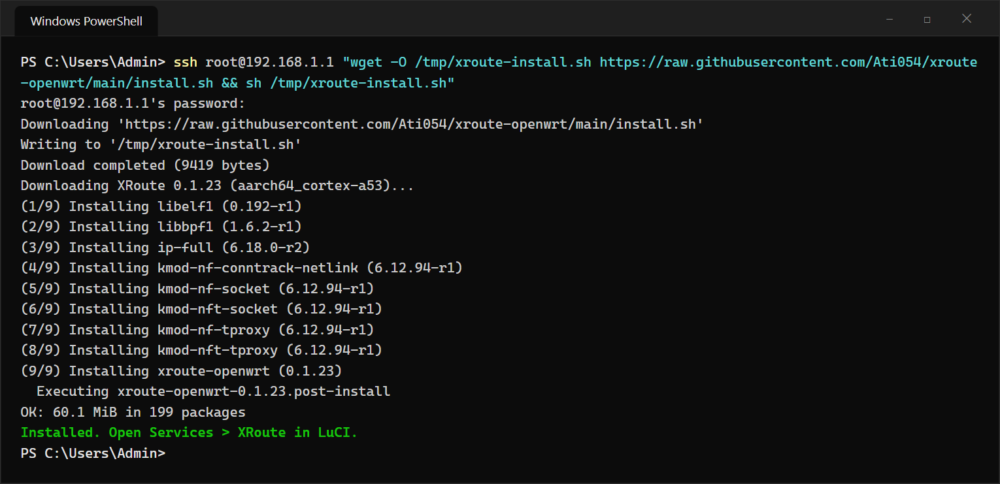
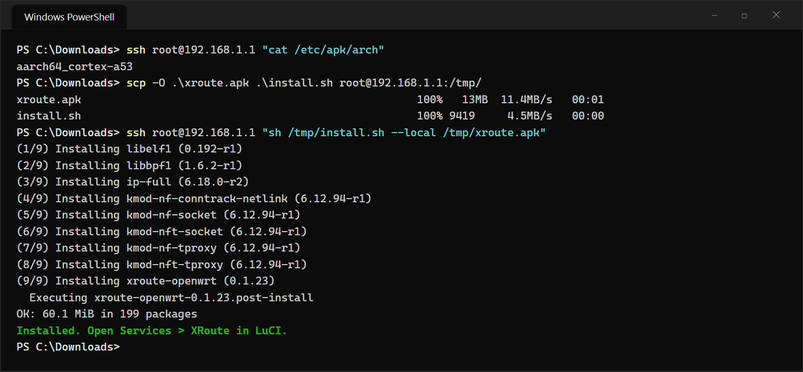
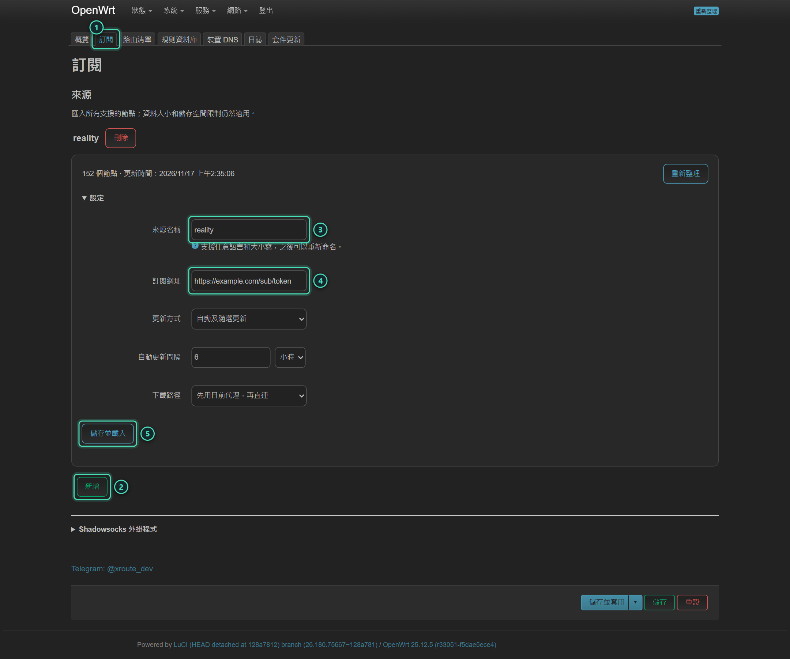
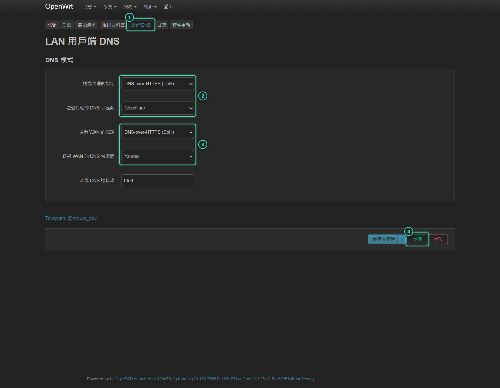
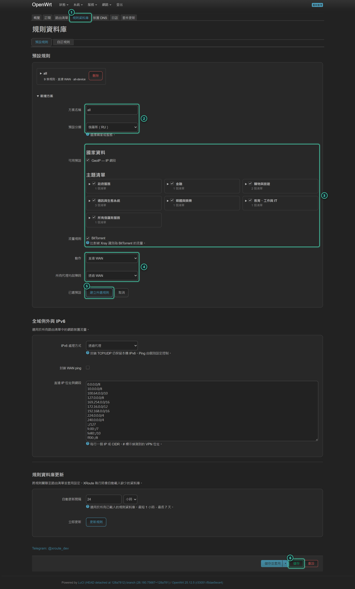
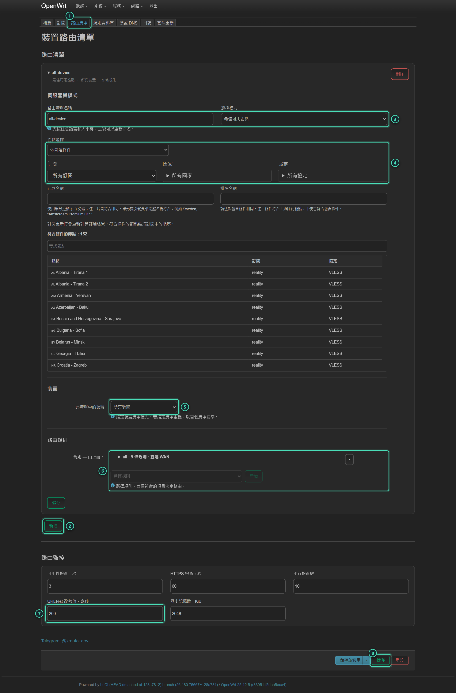
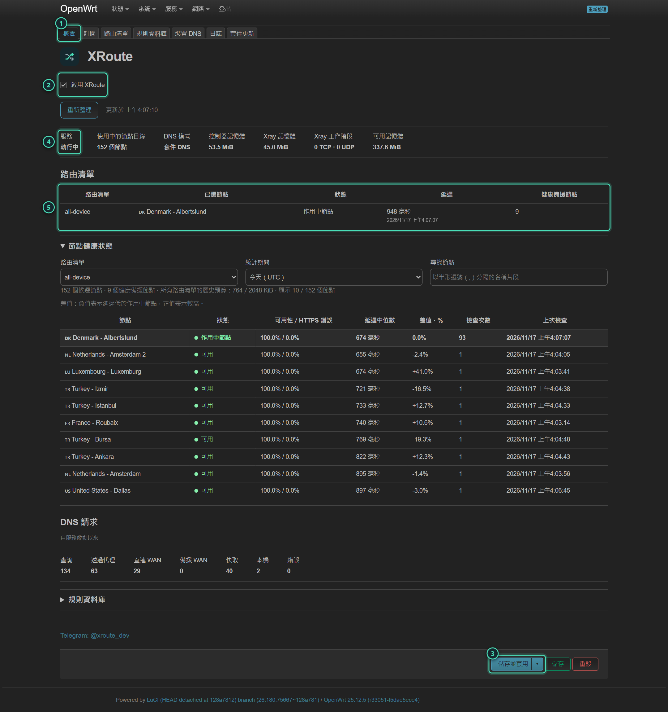

[English](SETUP.md) | [Русский](SETUP-RU.md) | [فارسی](SETUP-FA.md) | [简体中文](SETUP-ZH.md) | [繁體中文](SETUP-ZH-TW.md)

# 在 OpenWrt 25.12 上安裝與設定 XRoute

適用於採用 `APK` 套件管理器的 **OpenWrt 25.12** 路由器初次設定逐步指南（支援 `aarch64_generic`、`aarch64_cortex-a53`、`x86_64` 架構，建議 256 MB 以上記憶體）。

安裝指令碼會下載最新穩定版。截圖中的版本號碼和節點數量僅供參考。

## 安裝套件

在電腦上開啟終端機（例如 **Windows PowerShell**）。請將下方指令中的 `192.168.1.1` 替換為您的路由器 IP 位址。

### 方式一：路由器可直接連線至 GitHub

執行單行指令。安裝指令碼會自動偵測架構、檢查可用空間與發行版簽章，並一併安裝套件與核心模組相依套件：

```powershell
ssh root@192.168.1.1 "wget -O /tmp/xroute-install.sh https://raw.githubusercontent.com/Ati054/xroute-openwrt/main/install.sh && sh /tmp/xroute-install.sh"
```



### 方式二：路由器無法連線至 GitHub

1. 查詢路由器的套件架構：
   ```powershell
   ssh root@192.168.1.1 "cat /etc/apk/arch"
   ```
2. 在電腦上從 [Releases](https://github.com/Ati054/xroute-openwrt/releases) 頁面下載對應架構的 `.apk` 檔案（重新命名為 `xroute.apk`）與 `install.sh`，放進同一個資料夾。
3. 在該資料夾開啟 PowerShell，將檔案傳送至路由器並執行本機安裝：
   ```powershell
   scp -O .\xroute.apk .\install.sh root@192.168.1.1:/tmp/
   ssh root@192.168.1.1 "sh /tmp/install.sh --local /tmp/xroute.apk"
   ```
   注意：路由器仍須能連線至 OpenWrt 官方套件庫，以便 `apk` 自動下載 `kmod-nft-tproxy` 等系統核心模組。



看到 `Installed. Open Services > XRoute in LuCI.` 訊息後，重新整理路由器 LuCI 網頁並開啟上方選單的 **服務 → XRoute**。

> [!IMPORTANT]
> 剛安裝完成時服務預設為停用，且在完成訂閱與路由清單設定前，啟用核取方塊會維持鎖定。請依序設定下方分頁，到最後一步再啟用 XRoute。

若使用 PassWall2 或 HomeProxy，請先在 **系統 → 啟動項目** 中停止它並停用自動啟動，再啟用 XRoute。

## 步驟一：訂閱

1. 開啟 **訂閱** 分頁（`1`）。
2. 點擊 **新增**（`2`）。
3. 在 **來源名稱**（`3`）輸入任意語言的名稱（例如 `我的訂閱` 或 `reality`）。
4. 在 **訂閱網址**（`4`）貼上您的 `https://` 訂閱連結。
5. 點擊 **儲存並載入**（`5`），等待卡片上方顯示已匯入的節點數量（如 `152 個節點`）。



## 步驟二：裝置 DNS

1. 開啟 **裝置 DNS** 分頁（`1`）。
2. 選擇 **透過代理** 的協定與供應商（`2`），例如 `DNS-over-HTTPS (DoH)` 與 `Cloudflare`。
3. 選擇無須代理即可回應的 **透過 WAN** 解析器（`3`）。截圖中的 `DoH` 和 `Yandex` 是俄羅斯網路的範例。`網路業者 DNS` 使用業者下發的 DNS 位址，不使用 DoH。
4. 點擊 **儲存**（`4`）。若路由器上正在執行 `https-dns-proxy`，頁面頂端也會出現接管 DNS 的確認核取方塊，勾選後再儲存即可。



## 步驟三：規則資料庫

此範例讓選定的國家規則與 BitTorrent 流量走 WAN，其餘流量走代理。截圖使用俄羅斯（RU）規則，請依需求選擇國家。

1. 開啟 **規則資料庫**（`1`）→ **預設規則**，展開 **新增方案**。
2. 輸入 **方案名稱**（例如 `all`），並在 **預設分類**（`2`）中選擇所需分類，例如 `中國（CN）`、`俄羅斯（RU）`、`伊朗（IR）` 或 `服務`。
3. 勾選需要的分類項目，可依需求勾選 **BitTorrent**（`3`）。
4. 確認 **動作**（直連例外選 `直連 WAN`，指定代理服務選 `透過此路由清單代理`）以及 **所有代理均故障時**（`4`）：預設為 `透過 WAN`，確保訂閱節點全部離線時一般網路不會中斷；若代理規則需要嚴格阻斷直連外洩，請改選 `封鎖`。
5. 點擊 **建立所選規則**（`5`），上方會出現建立完成的規則方案卡片。
6. 點擊頁面底部的 **儲存**（`6`）。



## 步驟四：路由清單

路由清單負責將區域網路裝置、訂閱節點與路由規則綁定在一起：

1. 開啟 **路由清單** 分頁（`1`）並點擊 **新增**（`2`）。
2. 填寫支援任意語言的 **路由清單名稱**（例如 `家庭裝置` 或 `all-device`），並選擇 **選擇模式**（`3`）：`最佳可用節點`（依 HTTPS `URLTest` 延遲自動選取）或 `優先順序／備援`（依固定順序容錯移轉並自動切回）。
3. 在 **節點選擇**（`4`）中，初次設定建議選 `依篩選條件`，保留 `所有訂閱`、`所有國家`、`所有協定`。下方名稱篩選欄位留空即可納入全部節點；若想手動勾選特定國家或伺服器，可切換為 `選擇位置`。
4. 在 **此清單中的裝置**（`5`）選擇 `所有裝置`（若僅供特定區網 IP 使用，請改選 `指定裝置`）。
5. 在 **路由規則**（`6`）下拉選單選取上一步建立的方案（例如 `all`），並點擊 `新增`。
6. 在 **路由監控** 中，將 **URLTest 改善值，毫秒**（`7`）保留為預設的 `50`，或依截圖設為 `200`。數值越高，切換節點所需的延遲改善就越大。
7. 點擊頁面底部的 **儲存**（`8`）。



## 步驟五：啟用與確認

1. 切換至 **概覽** 分頁（`1`）。
2. 勾選 **啟用 XRoute**（`2`）。
3. 點擊頁面底部的 **儲存並套用**（`3`）。
4. 等待 **服務** 顯示 `執行中`（`4`），所選節點顯示 `作用中節點`（`5`）。首次啟動也會下載已關聯的規則資料庫，可能需要超過 30 秒。展開 **節點健康狀態** 查看檢查結果與延遲，在 **DNS 請求** 中檢視查詢計數。


