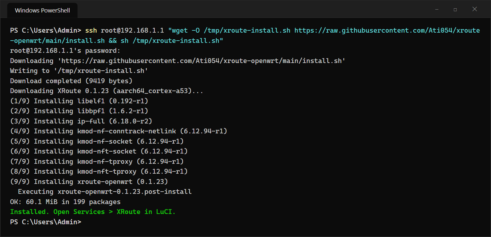
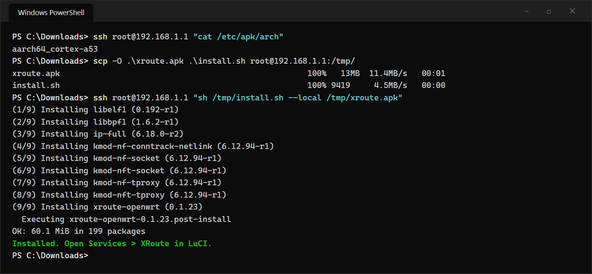
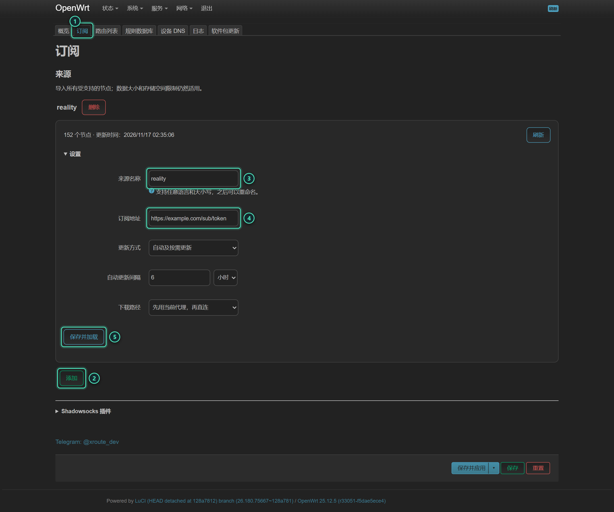
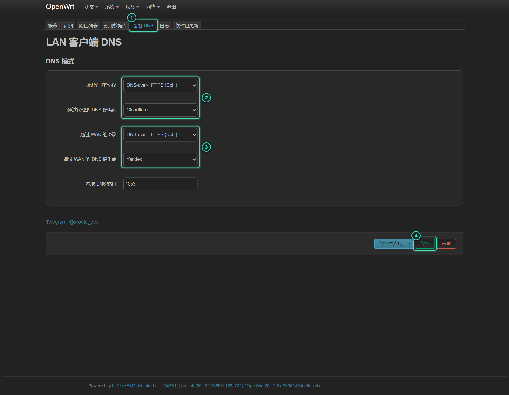
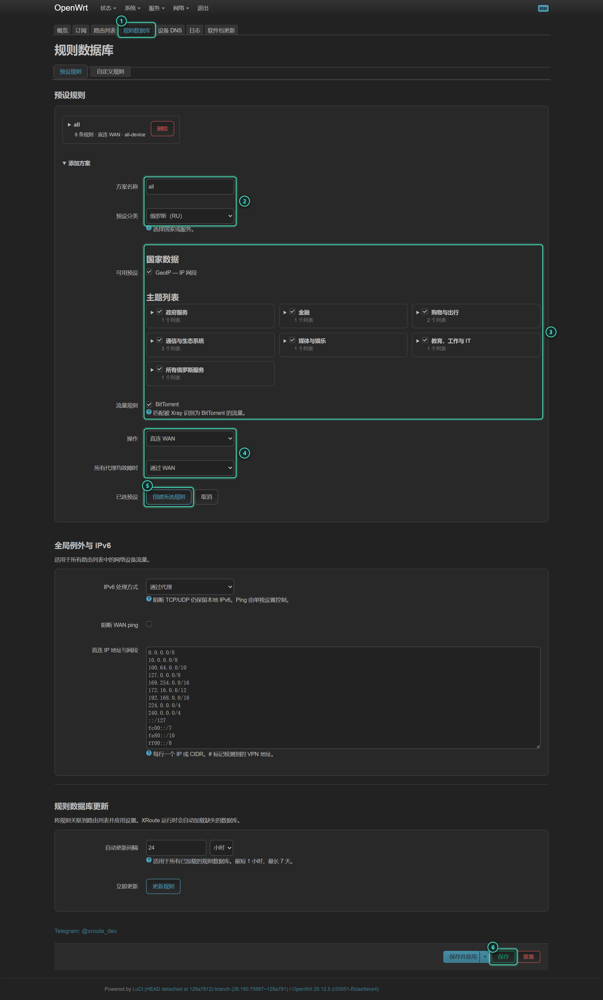
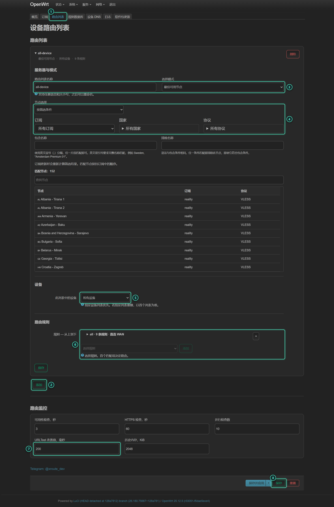
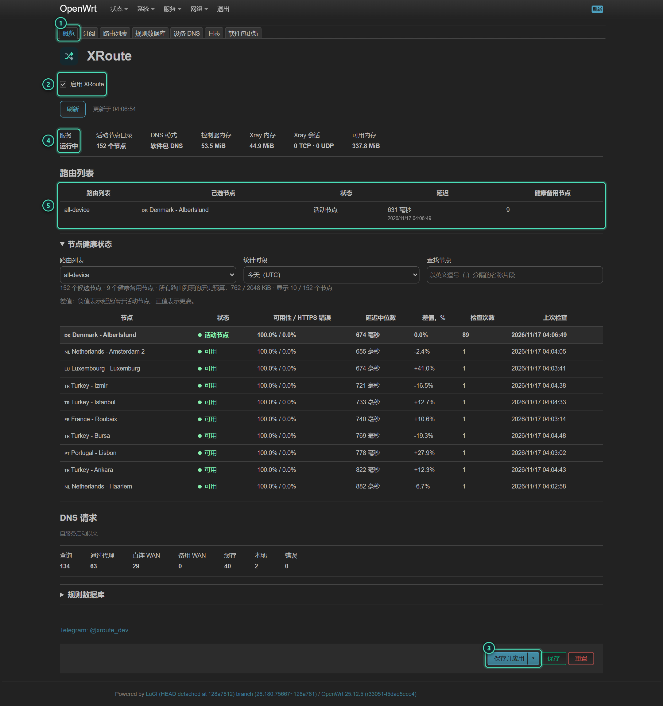

[English](SETUP.md) | [Русский](SETUP-RU.md) | [فارسی](SETUP-FA.md) | [简体中文](SETUP-ZH.md) | [繁體中文](SETUP-ZH-TW.md)

# 在 OpenWrt 25.12 上安装与配置 XRoute

适用于采用 `APK` 软件包管理器的 **OpenWrt 25.12** 路由器从零开始配置指南（支持 `aarch64_generic`、`aarch64_cortex-a53`、`x86_64` 架构，建议 256 MB 及以上内存）。

安装脚本会下载最新稳定版。截图中的版本号和节点数量仅作示例。

## 安装软件包

在电脑上打开终端（例如 **Windows PowerShell**）。请将下方命令中的 `192.168.1.1` 替换为你的路由器 IP 地址。

### 方式一：路由器可直接访问 GitHub

执行以下命令。安装脚本会自动识别架构、检查剩余空间与发行版签名，并安装软件包及所需内核依赖：

```powershell
ssh root@192.168.1.1 "wget -O /tmp/xroute-install.sh https://raw.githubusercontent.com/Ati054/xroute-openwrt/main/install.sh && sh /tmp/xroute-install.sh"
```



### 方式二：路由器无法访问 GitHub

1. 查看路由器的软件包架构：
   ```powershell
   ssh root@192.168.1.1 "cat /etc/apk/arch"
   ```
2. 在电脑上从 [Releases](https://github.com/Ati054/xroute-openwrt/releases) 页面下载对应架构的 `.apk` 文件（重命名为 `xroute.apk`）以及 `install.sh`，放入同一文件夹。
3. 在该文件夹中打开 PowerShell，上传文件并执行本地安装：
   ```powershell
   scp -O .\xroute.apk .\install.sh root@192.168.1.1:/tmp/
   ssh root@192.168.1.1 "sh /tmp/install.sh --local /tmp/xroute.apk"
   ```
   注意：路由器仍需能够访问 OpenWrt 官方软件源，以便 `apk` 自动安装 `kmod-nft-tproxy` 等系统内核模块。



终端显示 `Installed. Open Services > XRoute in LuCI.` 后，刷新路由器 LuCI 网页并在顶部菜单打开 **服务 → XRoute**。

> [!IMPORTANT]
> 刚安装完成时服务默认处于关闭状态，且在完成订阅和路由列表配置之前启用复选框会保持锁定。请依次完成下方各标签页设置，在最后一步再启用服务。

如果你使用 PassWall2 或 HomeProxy，请先在 **系统 → 启动项** 中停止它并禁用自启动，再启用 XRoute。

## 第一步：订阅

1. 打开 **订阅** 标签页（`1`）。
2. 点击 **添加**（`2`）。
3. 在 **来源名称**（`3`）中输入任意语言的名称（例如 `我的订阅` 或 `reality`）。
4. 在 **订阅地址**（`4`）中粘贴你的 `https://` 订阅链接。
5. 点击 **保存并加载**（`5`），等待卡片上方显示已导入的节点数量（如 `152 个节点`）。



## 第二步：设备 DNS

1. 打开 **设备 DNS** 标签页（`1`）。
2. 选择 **通过代理** 的协议与提供商（`2`），例如 `DNS-over-HTTPS (DoH)` 与 `Cloudflare`。
3. 选择无需代理即可响应的 **通过 WAN** 解析器（`3`）。截图中的 `DoH` 和 `Yandex` 是俄罗斯网络的示例。`运营商 DNS` 使用运营商下发的 DNS 地址，不使用 DoH。
4. 点击 **保存**（`4`）。如果路由器上正在运行 `https-dns-proxy`，页面顶部还会出现接管 DNS 的确认复选框，勾选后再保存即可。



## 第三步：规则数据库

本例让选定的国家规则和 BitTorrent 流量走 WAN，其余流量走代理。截图使用俄罗斯（RU）规则，请按需要选择国家。

1. 打开 **规则数据库**（`1`）→ **预设规则**，展开 **添加方案**。
2. 填写 **方案名称**（例如 `all`），并在 **预设分类**（`2`）中选择所需分类，例如 `中国（CN）`、`俄罗斯（RU）`、`伊朗（IR）` 或 `服务`。
3. 勾选需要的分类列表，可按需勾选 **BitTorrent**（`3`）。
4. 检查 **操作**（直连例外选 `直连 WAN`，指定代理服务选 `通过此路由列表代理`）与 **所有代理均故障时**（`4`）：默认值为 `通过 WAN`，避免订阅节点全部离线时普通网页断网；若代理规则需要严格防泄漏阻断，可改为 `阻断`。
5. 点击 **创建所选规则**（`5`），顶部会生成对应的规则方案卡片。
6. 点击页面底部的 **保存**（`6`）。



## 第四步：路由列表

路由列表用于把局域网设备、订阅节点和分流规则关联在一起：

1. 打开 **路由列表** 标签页（`1`）并点击 **添加**（`2`）。
2. 填写支持任意语言的 **路由列表名称**（例如 `家庭设备` 或 `all-device`），并选择 **选择模式**（`3`）：`最佳可用节点`（按 HTTPS `URLTest` 延迟自动优选）或 `优先级／备用`（按固定顺序故障切换并自动回切）。
3. 在 **节点选择**（`4`）中，初次上手最省事的做法是选择 `按筛选条件`，保留 `所有订阅`、`所有国家`、`所有协议`。下方名称筛选框留空即可纳入全部订阅节点；如需手动勾选特定地区或单节点，可切换为 `选择位置`。
4. 在 **此列表中的设备**（`5`）中选择 `所有设备`（若仅针对局域网内部分 IP 分流，选择 `指定设备`）。
5. 在 **路由规则**（`6`）下拉框中选中上一步创建的方案（例如 `all`），点击右侧 `添加`。
6. 在 **路由监控** 中，将 **URLTest 改善值，毫秒**（`7`）保留为默认的 `50`，或按截图设置为 `200`。数值越高，切换节点所需的延迟改善就越大。
7. 点击页面底部的 **保存**（`8`）。



## 第五步：启用与验证

1. 切换到 **概览** 标签页（`1`）。
2. 勾选 **启用 XRoute**（`2`）。
3. 点击页面底部的 **保存并应用**（`3`）。
4. 等待 **服务** 显示 `运行中`（`4`），所选节点显示 `活动节点`（`5`）。首次启动还会下载已关联的规则数据库，可能需要超过 30 秒。展开 **节点健康状态** 查看检查结果和延迟，在 **DNS 请求** 中查看查询计数。


