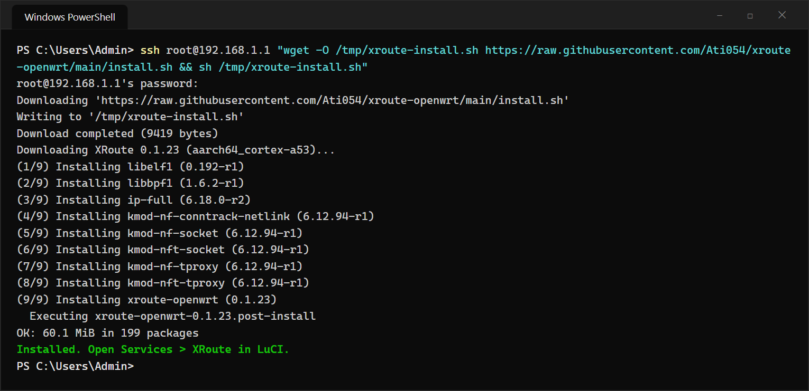
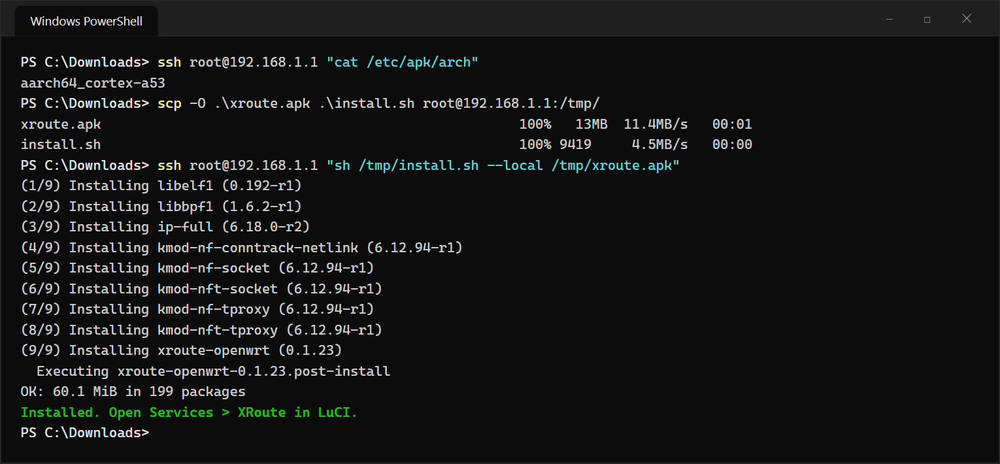
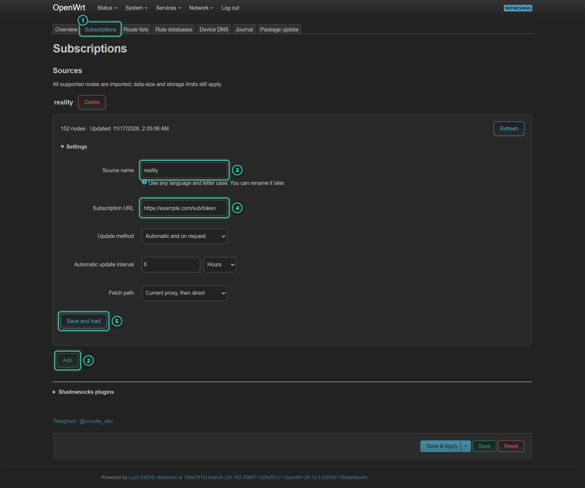
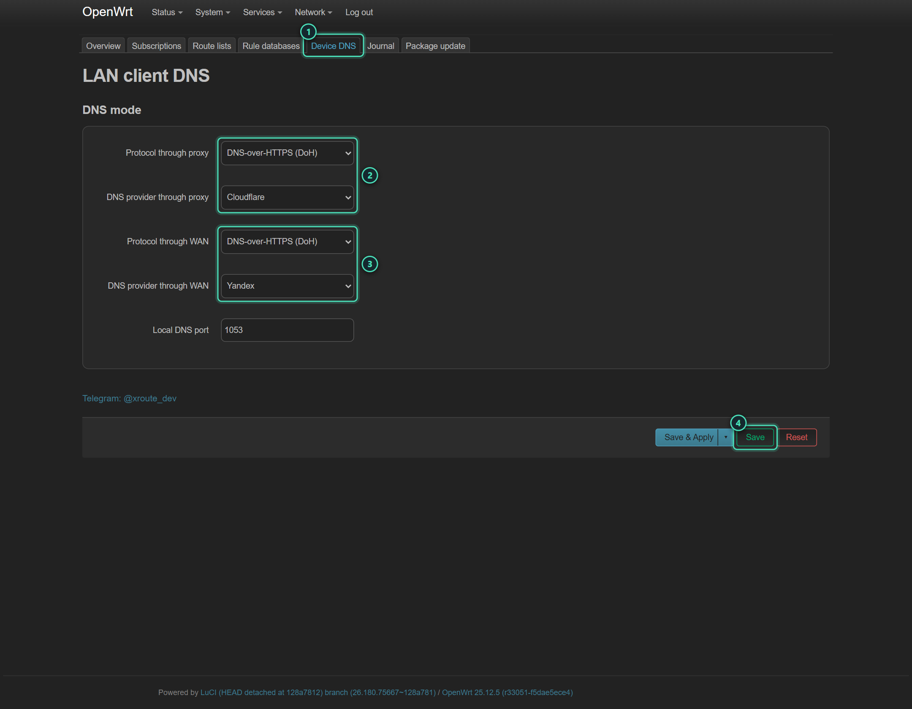
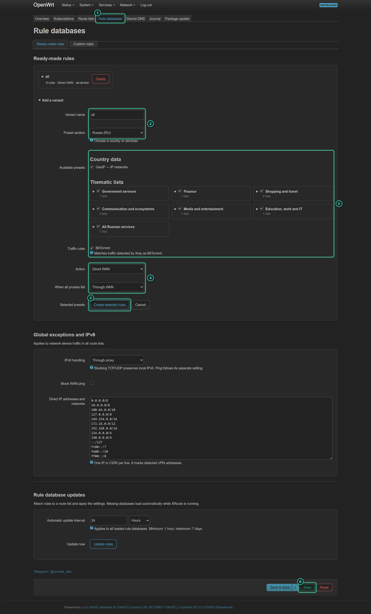
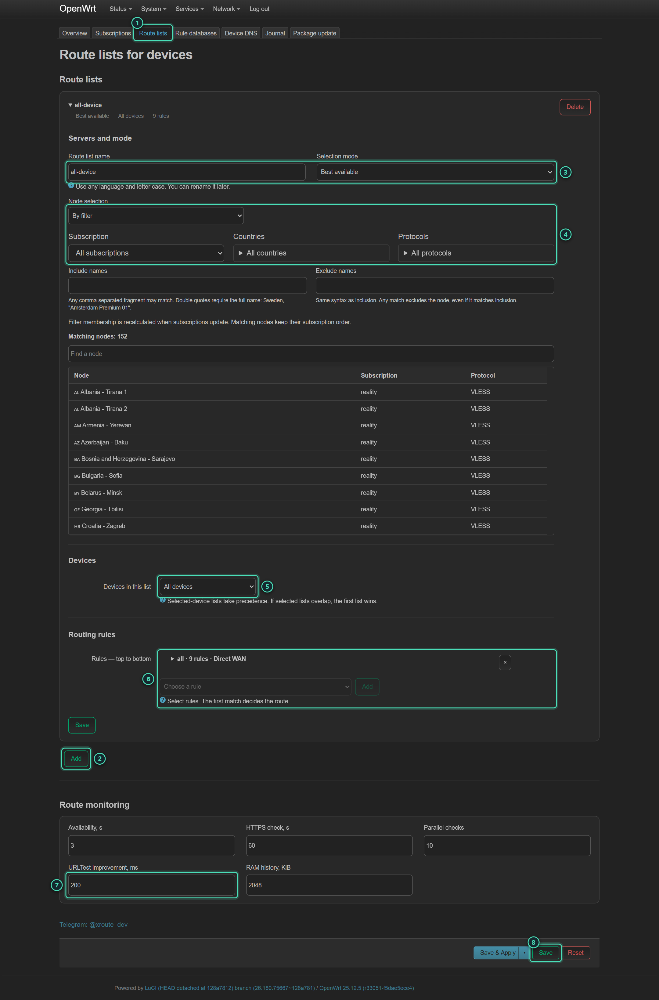
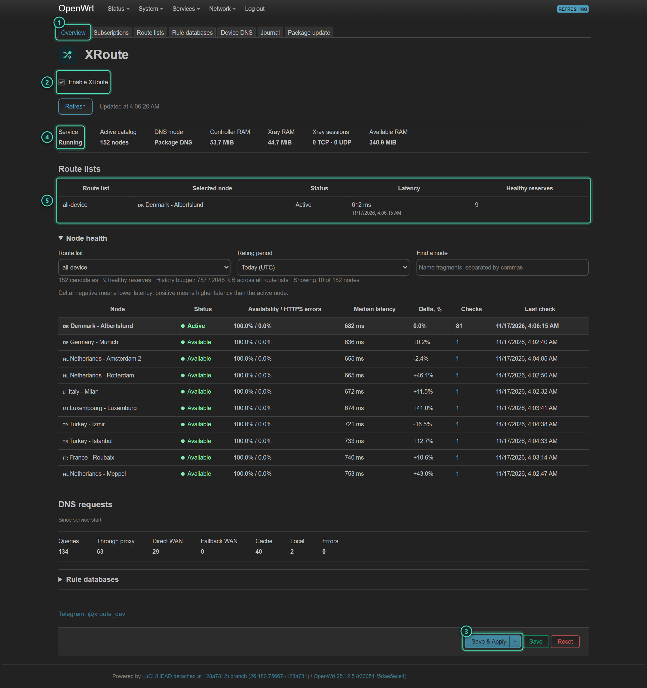

[English](SETUP.md) | [Русский](SETUP-RU.md) | [فارسی](SETUP-FA.md) | [简体中文](SETUP-ZH.md) | [繁體中文](SETUP-ZH-TW.md)

# Installing and Setting Up XRoute on OpenWrt 25.12

Step-by-step first-time setup for **OpenWrt 25.12** routers using the `APK` package manager (`aarch64_generic`, `aarch64_cortex-a53`, `x86_64`, 256 MB RAM recommended).

The installer downloads the latest stable release. Version and node counts in the screenshots are examples.

## Package Installation

Open a terminal on your computer (for example, **Windows PowerShell**). Replace `192.168.1.1` in the commands below with your router's IP address.

### Option 1. GitHub is reachable from the router

Run a single command. The installer detects your router architecture, checks available storage and the release signature, and installs the package with its kernel dependencies:

```powershell
ssh root@192.168.1.1 "wget -O /tmp/xroute-install.sh https://raw.githubusercontent.com/Ati054/xroute-openwrt/main/install.sh && sh /tmp/xroute-install.sh"
```



### Option 2. GitHub is blocked or unreachable on the router

1. Check the package architecture on your router:
   ```powershell
   ssh root@192.168.1.1 "cat /etc/apk/arch"
   ```
2. Download the matching `.apk` file (rename it to `xroute.apk`) and `install.sh` from [Releases](https://github.com/Ati054/xroute-openwrt/releases) into the same folder on your computer.
3. Open PowerShell in that folder, copy both files to the router, and run the local install:
   ```powershell
   scp -O .\xroute.apk .\install.sh root@192.168.1.1:/tmp/
   ssh root@192.168.1.1 "sh /tmp/install.sh --local /tmp/xroute.apk"
   ```
   Official OpenWrt package repositories still need to be reachable from the router so `apk` can pull the `kmod-nft-tproxy` kernel modules.



Once you see `Installed. Open Services > XRoute in LuCI.`, refresh the LuCI web interface and open **Services → XRoute**.

> [!IMPORTANT]
> Right after installation, XRoute is off and the enable checkbox stays locked until a subscription and a route list are configured. Go through the tabs below in order and enable XRoute on the final step.

If you use PassWall2 or HomeProxy, stop it and disable its autostart in **System → Startup** before enabling XRoute.

## Step 1. Subscriptions

1. Open the **Subscriptions** tab (`1`).
2. Click **Add** (`2`).
3. Enter a **Source name** (`3`) in any language (for example, `My subscription` or `reality`).
4. Paste your `https://` link into **Subscription URL** (`4`).
5. Click **Save and load** (`5`) and wait until the imported node count appears (`152 nodes`).



## Step 2. Device DNS

1. Open the **Device DNS** tab (`1`).
2. Choose the resolver **through proxy** (`2`), such as `DNS-over-HTTPS (DoH)` and `Cloudflare`.
3. Choose a resolver **through WAN** (`3`) that answers without the proxy. The screenshot uses `DoH` and `Yandex` as an example for Russia. `ISP DNS through WAN` uses the DNS addresses supplied by your ISP; it is not DoH.
4. Click **Save** (`4`). If `https-dns-proxy` is active on the router, a DNS takeover confirmation checkbox will also appear at the top of this page; tick it before saving.



## Step 3. Rule Databases

In this example, selected country rules and BitTorrent go through WAN; other traffic goes through the proxy. The screenshots use Russia (RU). Choose the country rules you need.

1. Open **Rule databases** (`1`) → **Ready-made rules** and expand **Add a variant**.
2. Enter a **Variant name** (for example, `all`) and select a **Preset section** (`2`), such as `Russia (RU)`, `China (CN)`, `Iran (IR)`, or `Services`.
3. Select the desired preset categories and optionally tick **BitTorrent** (`3`).
4. Check **Action** (`Direct WAN` for direct bypass rules or `Proxy through this route list` for proxied services) and **When all proxies fail** (`4`): `Through WAN` is selected by default so regular internet stays up if all subscription nodes go down. Switch to `Block` if you require strict fail-closed blocking on proxy rules.
5. Click **Create selected rules** (`5`). A summary card for the variant will appear at the top.
6. Click **Save** (`6`) at the bottom of the page.



## Step 4. Route Lists

A route list connects LAN devices, subscription nodes, and routing rules:

1. Open the **Route lists** tab (`1`) and click **Add** (`2`).
2. Enter a **Route list name** in any language (for example, `Home devices` or `all-device`) and pick a **Selection mode** (`3`): `Best available` (automatic HTTPS `URLTest` selection) or `Priority / reserve` (ordered failover with automatic return).
3. Under **Node selection** (`4`), the quickest start is `By filter` with `All subscriptions`, `All countries`, and `All protocols`. Leave the name filter fields empty to include every node from your subscription, or switch to `Choose locations` to pick specific countries or servers.
4. Set **Devices in this list** (`5`) to `All devices` (or `Selected devices` if this route list is only for specific LAN IPs).
5. Under **Routing rules** (`6`), choose the rule variant created in the previous step (for example, `all`) and click `Add`.
6. Under **Route monitoring**, leave **URLTest improvement, ms** (`7`) at the default `50`, or set `200` as shown. A higher threshold requires a larger latency improvement before switching.
7. Click **Save** (`8`) at the bottom of the page.



## Step 5. Enable and Verify

1. Open the **Overview** tab (`1`).
2. Tick **Enable XRoute** (`2`).
3. Click **Save & Apply** (`3`) at the bottom of the page.
4. Wait for **Service** to show `Running` (`4`) and your selected node to show `Active` (`5`). The first start also downloads the attached rule databases, so it can take longer than 30 seconds. Expand **Node health** for checks and latency; **DNS requests** shows the DNS counters.


